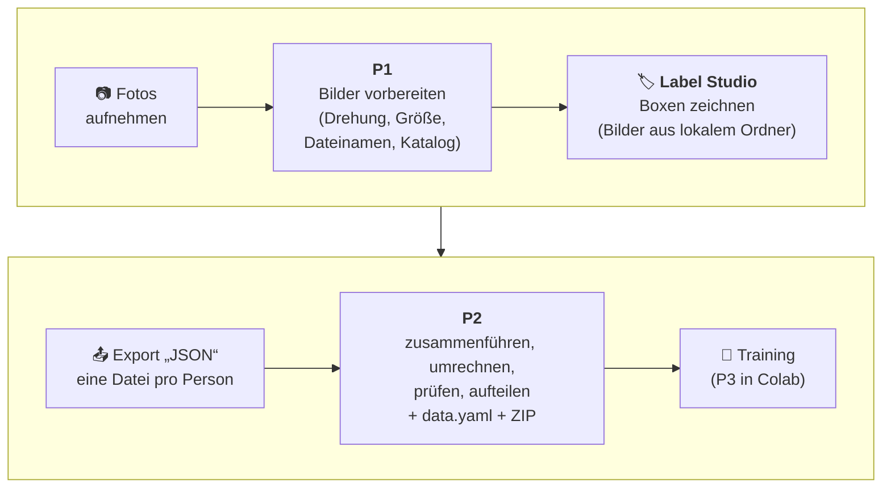

# Daten labeln

**Labeln** (auch *Annotieren*) heißt: Ein Mensch markiert auf jedem Trainingsbild, **was wo** zu sehen ist.
Das Modell lernt anschließend, diese Markierungen nachzuahmen. Die Labels sind also die **„richtigen Antworten“** –
in der Fachsprache die **Ground Truth**.

## Das YOLO-Label-Format

Für die Detektion ist jede Label-Datei eine einfache Textdatei. **Eine Zeile = ein Objekt**:

```text
<klasse> <x_mitte> <y_mitte> <breite> <höhe>
```

```text title="labels/train/platine_07.txt"
0 0.692923 0.504944 0.037852 0.201875
2 0.502718 0.552890 0.033120 0.315430
2 0.443986 0.491000 0.089898 0.249918
```

- **klasse** ist die Nummer der Klasse (beginnend bei **0**), die Namen stehen in der [data.yaml](data-yaml.md).
- Alle Koordinaten sind **normiert** auf 0 … 1: x-Werte werden durch die Bildbreite geteilt, y-Werte durch die Bildhöhe.
- (0, 0) ist **links oben**, (1, 1) ist rechts unten.

!!! question "Warum normiert und nicht in Pixeln?"
    ??? success "Antwort"
        Weil das Bild beim Training **skaliert** wird (z. B. auf 640 px). Normierte Werte bleiben dabei gleich –
        Pixelwerte müssten jedes Mal umgerechnet werden. Außerdem funktionieren die Labels so mit jeder Bildauflösung.

### 🧪 Experiment: Selbst labeln

Wähle eine Klasse und ziehe mit der Maus Boxen um die Objekte. Rechts siehst du live, was in der Label-Datei steht.

<div class="exp" data-exp="label" data-klassen="person,bus" data-bild="../../assets/img/bus.jpg"></div>

!!! example "Aufgaben zum Experiment"
    1. Labele **alle Personen und den Bus**. Wie viele Zeilen hat die Datei?
    2. Ziehe eine Box ganz oben links in die Ecke. Welche Werte erwartest du für `x_mitte` und `y_mitte`? Stimmt es?
    3. Die Person ganz rechts ist nur halb im Bild. **Labeln oder nicht?** Diskutiert!
       *(Regel: Ja – sichtbare Teile von Objekten werden gelabelt, sonst lernt das Modell, angeschnittene Objekte zu ignorieren.)*

## Regeln für gute Labels

!!! success "So geht's richtig"
    - **Eng** um das Objekt – ohne Lücke, aber auch nichts abschneiden.
    - **Jedes** Objekt der Klasse auf **jedem** Bild labeln. Ein vergessenes Objekt bringt dem Modell bei: „Das ist Hintergrund.“
    - **Einheitlich** bleiben: Wenn bei Widerständen die Anschlussdrähte zur Box gehören, dann bei **allen**.
    - Auch **teilweise verdeckte** und **angeschnittene** Objekte labeln.
    - **Hintergrundbilder** (ohne Objekte, mit leerer oder ohne `.txt`) sind erlaubt und helfen gegen Fehlalarme (~5–10 %).

!!! failure "Typische Fehler"
    - Klassen verwechselt (Kondensator als Widerstand gelabelt)
    - Boxen zu groß mit viel Hintergrund
    - Doppelte Boxen auf demselben Objekt
    - Handyfotos mit **falscher Drehung** (EXIF-Problem, siehe unten)

## Werkzeuge zum Labeln

| Tool | Art | Besonderheit |
|---|---|---|
| **[Label Studio](https://labelstud.io/)** | Open Source, läuft lokal | **unser Werkzeug** – Daten bleiben auf dem eigenen Rechner, Export u. a. als JSON und YOLO |
| [CVAT](https://www.cvat.ai/) | Open Source / Online | sehr mächtig, auch für Videos |
| [Roboflow](https://roboflow.com/) | Online-Dienst | KI-unterstütztes Labeln, Daten liegen in der Cloud |
| [Ultralytics Platform](https://platform.ultralytics.com/) | Online-Dienst | Labeln, Trainieren und Ausrollen an einem Ort |

## Unser Ablauf im Projekt

Im eigenen Projekt (Einheit 5) labelst du mit **Label Studio**. Zwei Notebooks erledigen alles drumherum:



| Notebook | Aufgabe | Mehr dazu |
|---|---|---|
| **P1** – Daten sammeln | Steckbrief und Klassen festlegen, Fotos importieren (EXIF-Drehung, Verkleinern, eindeutige Namen), sichten, Qualität prüfen | [P1 · Daten sammeln](../projekt/p1-daten-sammeln.md) |
| **P2** – Labeln und prüfen | Label Studio starten und einrichten, JSON-Exporte zusammenführen, ins YOLO-Format umrechnen, Labels kontrollieren, train/val/test aufteilen | [P2 · Labeln und prüfen](../projekt/p2-labeln.md) |

### Label Studio starten (mit uv)

Im Projekt startet P2 Label Studio für dich, mit Zugriff auf deinen Bilderordner. Zum schnellen Ausprobieren
geht es auch direkt im Terminal:

```bash
uvx --python 3.12 label-studio==1.23.2 start
```

Das lädt Label Studio einmalig herunter und öffnet es im Browser unter `http://localhost:8080`.
Beim ersten Start legst du ein lokales Konto an. Es bleibt auf deinem Rechner.

Die Einrichtung mit Screenshots, also Label-Konfiguration, lokaler Ordner und Export, steht auf der Seite
[P2 · Labeln und prüfen](../projekt/p2-labeln.md#34-label-studio-mit-lokalem-ordner).

!!! warning "Das EXIF-Problem bei Handyfotos"
    Handys speichern Hochkant-Fotos oft **quer** und vermerken nur in den Metadaten (EXIF): „Bitte um 90° drehen“.
    Die Bildbetrachter machen das automatisch, manche Label-Tools und Trainingsskripte aber nicht.
    Dann passen **Boxen und Bild nicht zusammen**. P1 dreht die Bilder deshalb vor dem Labeln „fest“.

!!! tip "Wie viele Bilder brauche ich?"
    Als grober Richtwert für ein solides Schulprojekt mit Transfer Learning:
    **200–300 Objekte (Boxen) pro Klasse**, mindestens aber etwa 100 (→ [Gute Trainingsbilder](../projekt/bilder-aufnehmen.md)). Wichtiger als die reine Zahl ist die **Vielfalt**:
    unterschiedliche Hintergründe, Lichtverhältnisse, Winkel, Abstände – so, wie es später im Einsatz auch vorkommt.

<div class="quiz" data-titel="Kurz-Check: Labeln" data-quiz='[
 {"q": "Was bedeutet die Zeile „1 0.5 0.5 0.2 0.4“ in einer YOLO-Label-Datei?",
  "a": ["Klasse 1, Box in der Bildmitte, 20 % so breit und 40 % so hoch wie das Bild", "Klasse 1 mit 50 % Confidence", "Box von Pixel 0.5 bis 0.2", "Bild Nummer 1 ist zu 50 % fertig"],
  "c": 0, "e": "Format: Klasse, x_mitte, y_mitte, Breite, Höhe – alles normiert auf 0 bis 1."},
 {"q": "Auf einem Trainingsbild sind 5 Schrauben, du labelst nur 3. Was lernt das Modell daraus?",
  "a": ["Nichts, das ist egal", "Dass die 2 ungelabelten Schrauben Hintergrund sind – das verschlechtert das Modell", "Dass es mehr Schrauben suchen soll", "Es erkennt den Fehler automatisch"],
  "c": 1, "e": "Fehlende Labels sind falsche Antworten: Das Modell wird für richtige Erkennungen bestraft."},
 {"q": "Welches Format wählst du im Projekt beim Export aus Label Studio?",
  "a": ["CSV", "JSON-MIN", "JSON", "PNG"],
  "c": 2, "e": "Der JSON-Export enthält zu jeder Box den Originalpfad des Bildes. P2 rechnet daraus sicher ins YOLO-Format um."}
]'></div>
