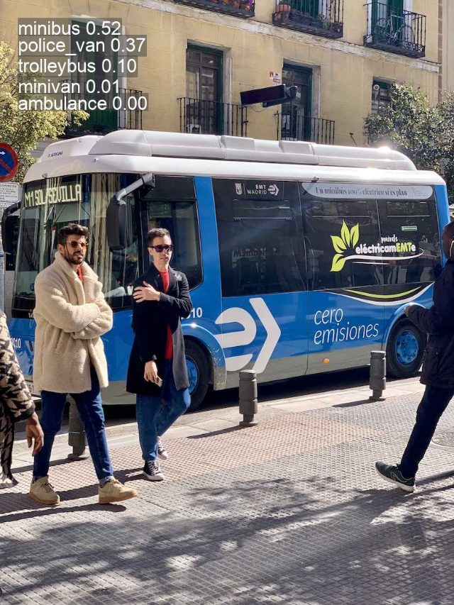
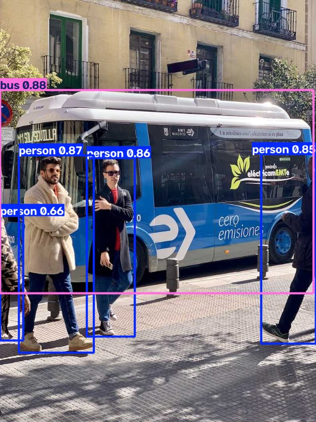
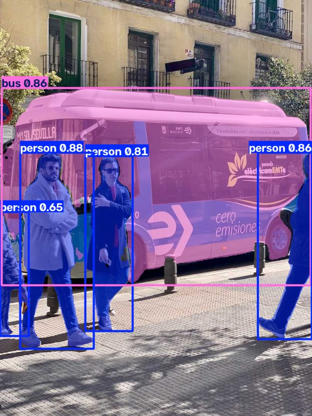
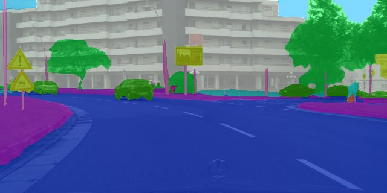
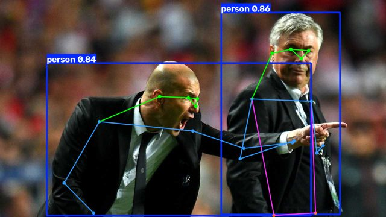
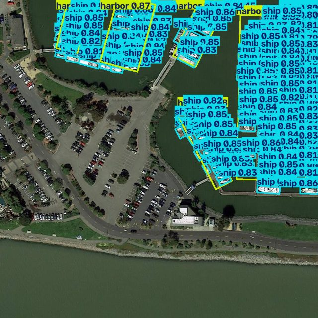
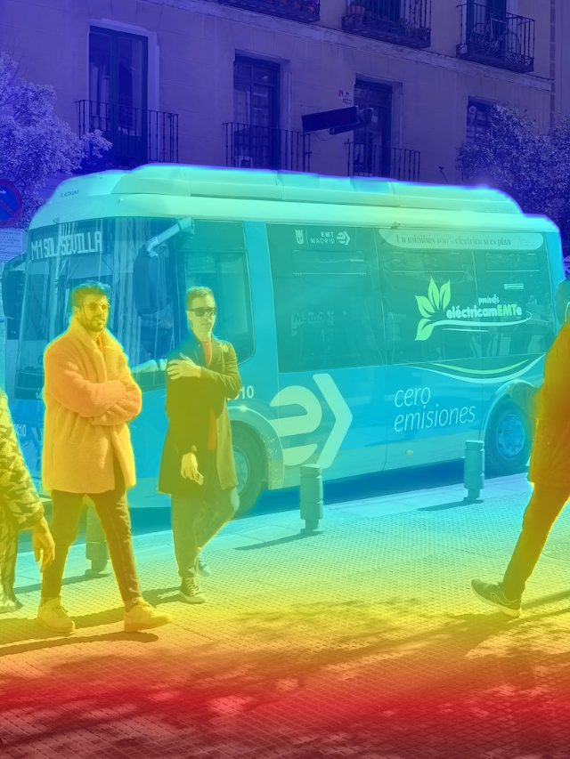

# Aufgabenarten (Tasks)

Eine Bilder-KI kann ganz unterschiedliche Fragen an ein Bild beantworten. Ultralytics nennt das **Tasks**.
Je nach Task ist die **Ausgabe** des Modells eine andere – und damit auch die Art, wie man die Trainingsbilder **labeln** muss.

!!! info "Die Beispielbilder auf dieser Seite"
    Alle Bilder unten wurden mit den vortrainierten **YOLO26n**-Modellen erzeugt (Beispielbilder aus dem Ultralytics-Paket
    sowie den Mini-Datensätzen DOTA8 und Cityscapes8). Du kannst sie später selbst mit einer Zeile Code nachbauen.

## Überblick

| Task | Frage | Ausgabe | Modell-Datei |
|---|---|---|---|
| **Klassifikation** | *Was* ist auf dem Bild? | eine Klasse + Wahrscheinlichkeit für das ganze Bild | `yolo26n-cls.pt` |
| **Detektion** | *Was* ist *wo*? | Rechteck-Boxen + Klasse + Confidence | `yolo26n.pt` |
| **Instanzsegmentierung** | Welche *Pixel* gehören zu *welchem einzelnen* Objekt? | Box + Pixel-Maske pro Objekt | `yolo26n-seg.pt` |
| **Semantische Segmentierung** | Welche *Klasse* hat *jeder Pixel*? | eine Klassenkarte für das ganze Bild | `yolo26n-sem.pt` |
| **Pose** | Wo sind die *Schlüsselpunkte*? | Box + Punkte (z. B. 17 Gelenke) | `yolo26n-pose.pt` |
| **OBB** | Was ist wo – *und wie gedreht*? | gedrehte Boxen + Winkel | `yolo26n-obb.pt` |

## Klassifikation – *Was ist auf dem Bild?*

<figure markdown>
{ loading=lazy }
<figcaption>Die Top-5-Klassen für das ganze Bild (ImageNet, 1000 Klassen).</figcaption>
</figure>

Das Modell gibt **eine Klasse für das gesamte Bild** aus – ohne zu sagen, *wo* das Objekt ist.

- ✅ sehr schnell, einfach zu labeln (Bilder nur in Ordner sortieren)
- ❌ keine Position, kein Zählen, nur ein „Hauptobjekt“

**Typische Anwendung:** Gut/Schlecht-Prüfung eines Bauteils, das immer gleich vor der Kamera liegt
(z. B. „Lötstelle in Ordnung“ / „Lötstelle fehlerhaft“).

## Detektion – *Was ist wo?*

<figure markdown>
{ loading=lazy }
<figcaption>Jedes Objekt bekommt eine Box, eine Klasse und eine Confidence.</figcaption>
</figure>

Der **Standard-Task** und Schwerpunkt dieses Kurses. Das Modell findet **mehrere Objekte** und gibt für jedes
eine **achsenparallele Box** (Rechteck), die **Klasse** und die **Confidence** aus.

- ✅ Objekte zählen und lokalisieren, schnell, gut labelbar
- ❌ Box ist nur ein Rechteck – die genaue Form fehlt

**Typische Anwendung:** Bauteile auf einer Platine zählen, fehlende Komponenten finden, Personen in einem Gefahrenbereich erkennen.

## Instanzsegmentierung – *Welche Pixel gehören zu welchem Objekt?*

<figure markdown>
{ loading=lazy }
<figcaption>Jede Person und der Bus haben eine eigene Maske.</figcaption>
</figure>

Wie Detektion – aber zusätzlich mit einer **Pixel-Maske** für **jedes einzelne Objekt**. Zwei Personen nebeneinander
sind zwei getrennte Masken.

- ✅ genaue Form und Fläche, z. B. für Flächenmessung
- ❌ aufwändiger zu labeln (Polygone statt Rechtecke), etwas langsamer

**Typische Anwendung:** Kabel oder Leiterbahnen vermessen, Kratzer/Korrosion flächig erfassen, Roboter-Greifen.

## Semantische Segmentierung – *Welche Klasse hat jeder Pixel?*

<figure markdown>
{ loading=lazy }
<figcaption>Straße, Gehweg, Gebäude, Vegetation, Autos … jeder Pixel ist eingefärbt (Cityscapes).</figcaption>
</figure>

Hier wird **jedem Pixel** des Bildes eine Klasse zugeordnet. Der Unterschied zur Instanzsegmentierung:
Es wird **nicht** zwischen einzelnen Objekten unterschieden – alle Autos sind einfach „Auto-Pixel“.

- ✅ ganze Szene verstehen, auch für „Flächen“ ohne klare Objekte (Straße, Himmel, Wiese)
- ❌ man kann nicht zählen, wie viele Objekte es sind

**Typische Anwendung:** autonomes Fahren (befahrbare Fläche), Solarmodul-Inspektion (defekte Zellflächen), Luftbilder.

!!! question "Denkfrage: Instanz oder semantisch?"
    Du willst wissen, **wie viele** Kondensatoren auf einer Platine sind *und* wie groß jeder ist. Welche Segmentierung brauchst du?

    ??? success "Lösung"
        **Instanzsegmentierung** – nur sie trennt die einzelnen Kondensatoren voneinander. Bei der semantischen Segmentierung
        wären benachbarte Kondensatoren eine zusammenhängende Fläche „Kondensator“.

## Pose – *Wo sind die Schlüsselpunkte?*

<figure markdown>
{ loading=lazy }
<figcaption>17 Körperpunkte pro Person, verbunden zu einem Skelett.</figcaption>
</figure>

Das Modell findet Objekte **und** bestimmte **Punkte** darauf, z. B. Schultern, Ellbogen, Knie.
Man kann auch eigene Schlüsselpunkte definieren (z. B. die Ecken eines Steckers).

- ✅ Haltung und Bewegung analysieren
- ❌ jeder Punkt muss beim Labeln einzeln gesetzt werden

**Typische Anwendung:** Ergonomie am Arbeitsplatz, Übungen zählen (Workout-Monitoring), Lage eines Bauteils für den Roboter.

## OBB – Oriented Bounding Boxes (gedrehte Boxen)

<figure markdown>
{ loading=lazy }
<figcaption>Schiffe im Luftbild: Die Boxen sind passend gedreht (DOTA-Datensatz).</figcaption>
</figure>

Wie Detektion, aber die Boxen dürfen **gedreht** sein. Bei schräg liegenden, länglichen Objekten passt ein normales
Rechteck schlecht – es enthält viel Hintergrund und überlappt mit Nachbarn.

- ✅ genaue Lage **und Winkel** schräger Objekte
- ❌ etwas aufwändiger zu labeln

**Typische Anwendung:** Luft- und Satellitenbilder, schräg liegende Bauteile auf dem Förderband, Ausrichtung von ICs vor dem Bestücken.

??? note "Bonus: Tiefenschätzung (Depth) – neu in YOLO26"
    <figure markdown>
    { loading=lazy width=420 }
    <figcaption>Aus einem normalen Foto geschätzte Entfernung: Helle bzw. warme Farben sind näher.</figcaption>
    </figure>

    YOLO26 kann aus einem **einzigen normalen Kamerabild** schätzen, wie weit jeder Pixel entfernt ist – ganz ohne
    Stereo- oder Lidar-Kamera (Modell `yolo26n-depth.pt`). Interessant z. B. für Roboter und Abstandswarnung.

## 🧪 Experiment: Welcher Task passt?

Ordne die Anwendungsfälle zu. Es gibt manchmal mehrere vertretbare Antworten – entscheidend ist die **Begründung**.

