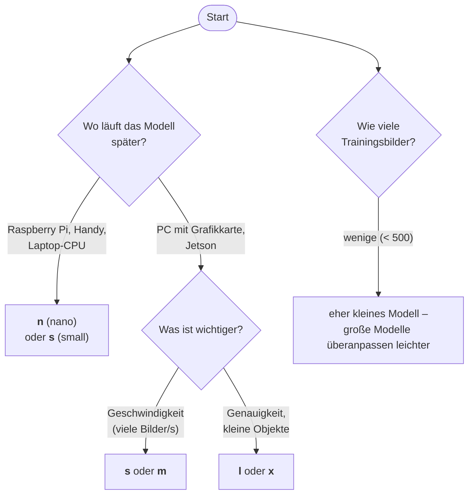

# Welches Modell?

## Die aktuelle Generation: YOLO26

Das aktuelle Modell von Ultralytics ist **YOLO26** (veröffentlicht im Januar 2026). Wir verwenden es in diesem Kurs.
Das Vorgängermodell **YOLO11** ist ebenfalls weit verbreitet und funktioniert mit denselben Befehlen –
du musst nur den Dateinamen ändern (`yolo11n.pt` statt `yolo26n.pt`).

!!! abstract "Was ist neu an YOLO26?"
    - **NMS-frei (End-to-End):** Das Modell kann direkt fertige Boxen ausgeben, ohne nachgelagerte NMS. Das vereinfacht den Einsatz auf Kleinstrechnern.
    - **Bis zu 43 % schneller auf CPUs** als YOLO11 (Größe *nano*) – wichtig für Geräte ohne Grafikkarte.
    - **Besser bei kleinen Objekten** durch ein verbessertes Training.
    - **Sieben Tasks** in einer Modellfamilie – inklusive semantischer Segmentierung und Tiefenschätzung.

## Fünf Größen: n, s, m, l, x

Jedes Modell gibt es in fünf Größen. Der Buchstabe steht am Ende des Namens: `yolo26`**`n`**`.pt`.

| Modell | Größe | mAPval 50-95 | CPU (ONNX) ms | GPU T4 (TensorRT) ms | Parameter (Mio.) | Rechenaufwand (GFLOPs) |
|---|---|---|---|---|---|---|
| **YOLO26n** | nano | 40,9 | 38,9 | 1,7 | 2,4 | 5,5 |
| **YOLO26s** | small | 48,6 | 87,2 | 2,5 | 9,5 | 20,9 |
| **YOLO26m** | medium | 53,1 | 220,0 | 4,7 | 20,4 | 68,4 |
| **YOLO26l** | large | 55,0 | 286,2 | 6,2 | 24,8 | 86,8 |
| **YOLO26x** | extra large | 57,5 | 525,8 | 11,8 | 55,7 | 194,4 |

<small>Detektion auf dem COCO-Datensatz bei 640 px. Quelle: [Ultralytics YOLO26 Dokumentation](https://docs.ultralytics.com/models/yolo26/).</small>

!!! question "Lies die Tabelle!"
    1. Um welchen Faktor ist **YOLO26x** auf der CPU langsamer als **YOLO26n**?
    2. Wie viel **mAP** gewinnst du dafür?
    3. Wie viele Bilder pro Sekunde schafft YOLO26n ungefähr auf der CPU? *(Tipp: 1000 ms ÷ Zeit pro Bild)*

    ??? success "Lösung"
        1. 525,8 ms ÷ 38,9 ms ≈ **13,5-mal langsamer**.
        2. 57,5 − 40,9 = **16,6 Prozentpunkte** mehr mAP.
        3. 1000 ÷ 38,9 ≈ **25 Bilder pro Sekunde** – für viele Anwendungen schon „Echtzeit“.

### Die offizielle Vergleichsgrafik

[{ loading=lazy }](https://docs.ultralytics.com/models/yolo26/)
<small>Grafik: © Ultralytics, [docs.ultralytics.com/models/yolo26](https://docs.ultralytics.com/models/yolo26/) (AGPL-3.0). Die Grafik wird direkt von Ultralytics geladen.</small>

**So liest du die Grafik:** Nach **rechts** wird das Modell langsamer (mehr Millisekunden pro Bild), nach **oben** genauer (mAP).
Jeder Punkt auf einer Linie ist eine Größe (n → x). Ein Modell ist umso besser, je **weiter links oben** seine Linie liegt –
es ist dann bei gleicher Geschwindigkeit genauer.

??? note "Vertiefung: Was bedeuten Parameter und GFLOPs?"
    - **Parameter** sind die Zahlen (Gewichte), die das Netz beim Training lernt. Mehr Parameter = mehr „Speicher“ für Wissen,
      aber auch größere Datei und mehr Rechenaufwand. YOLO26n hat 2,4 Millionen – ein großes Sprachmodell hat Hunderte Milliarden.
    - **GFLOPs** (Giga-Floating-Point-Operations) geben an, wie viele Milliarden Rechenoperationen für **ein** Bild nötig sind.
      Das ist ein hardwareunabhängiges Maß für den Rechenaufwand.
    - **mAP** (mean Average Precision) ist das wichtigste Gütemaß für Detektion. Du lernst es in der Einheit
      [Ergebnisse verstehen](../training/ergebnisse.md) genau kennen.

## Welches Modell für welchen Zweck?

!!! tip "Faustregeln für den Unterricht und die Praxis"
    1. **Starte immer mit `n` oder `s`.** Das Training ist schnell, du siehst sofort, ob Daten und Labels taugen.
    2. Erst wenn das funktioniert und die Genauigkeit nicht reicht: **eine Größe höher** probieren.
    3. **Mehr und bessere Daten bringen meist mehr als ein größeres Modell.**
    4. Denk an den **Einsatzort**: Was nützt ein `x`-Modell, wenn der Raspberry Pi 2 Sekunden pro Bild braucht?

## Vortrainiert vs. von Null

Fast immer startet man mit einem **vortrainierten** Modell (`yolo26n.pt`). Es kennt bereits Kanten, Formen und Texturen
aus Hunderttausenden COCO-Bildern. Beim eigenen Training wird es nur noch auf die neuen Klassen **angepasst** –
das nennt man **Transfer Learning**. So reichen oft schon wenige Hundert eigene Bilder.

| Datei | Bedeutung |
|---|---|
| `yolo26n.pt` | Architektur **+ vortrainierte Gewichte** → für eigenes Training empfohlen ✅ |
| `yolo26n.yaml` | nur der **Bauplan** der Architektur, zufällige Gewichte → Training von Null (braucht sehr viele Daten) |

