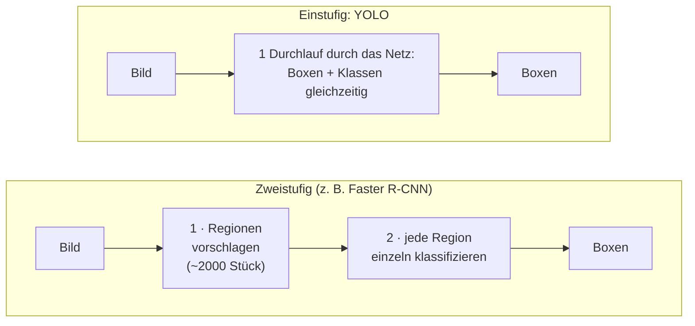

# YOLO & Ultralytics

## Was ist YOLO?

**YOLO** steht für **„You Only Look Once“** – „Du schaust nur einmal hin“. Es ist eine Familie von neuronalen Netzen,
die in **einem einzigen Durchlauf** durch das Netz alle Objekte in einem Bild findet: *wo* sie sind (Box) und *was*
sie sind (Klasse).

Das klingt selbstverständlich – war es aber lange nicht. Frühere Verfahren schauten sich ein Bild in vielen
Einzelschritten an. YOLO hat 2015 gezeigt, dass es auch in einem Schritt geht – und dadurch **echtzeitfähig** ist.



!!! abstract "Die Grundidee in drei Sätzen"
    1. Das Bild wird (gedanklich) in ein **Raster** aufgeteilt – bei 640 × 640 Pixeln in insgesamt 8400 Zellen auf drei Größenstufen.
    2. **Jede Zelle** sagt gleichzeitig vorher: Gibt es hier ein Objekt? Wo genau ist die Box? Welche Klasse?
    3. Am Ende werden unsichere und doppelte Vorhersagen herausgefiltert (Confidence-Schwelle und NMS) – das hast du in der [Live-Demo](live-demo.md) schon gesehen.

### Vorteile gegenüber herkömmlichen Verfahren

| | Klassische Bildverarbeitung<br/>(z. B. Schwellwert, Kantenfilter, Template Matching) | Zweistufige KI-Detektoren<br/>(z. B. Faster R-CNN) | **YOLO** |
|---|---|---|---|
| **Wie entsteht die Lösung?** | Regeln von Hand programmiert | aus Beispielen gelernt | aus Beispielen gelernt |
| **Robust bei Licht, Lage, Hintergrund?** | ❌ oft empfindlich | ✅ | ✅ |
| **Geschwindigkeit** | ✅ sehr schnell | ❌ langsam (mehrere Bilder/s) | ✅ Echtzeit (> 30 Bilder/s) |
| **Neue Objekte hinzufügen** | neu programmieren | neu trainieren (aufwändig) | neu trainieren (einfach) |
| **Läuft auf Kleinstrechnern** (Raspberry Pi, Jetson) | ✅ | ❌ | ✅ (kleine Modelle) |

!!! tip "Wann ist klassische Bildverarbeitung trotzdem besser?"
    Wenn die Umgebung **vollständig kontrolliert** ist (gleiches Licht, gleiche Position, gleicher Hintergrund) und
    die Aufgabe einfach ist – z. B. „Ist an Position X ein heller Fleck?“ – braucht man oft keine KI.
    KI lohnt sich, wenn Objekte **variieren** und Regeln kaum noch formulierbar sind.

## Kurze Geschichte – damit du YOLO einordnen kannst

| Jahr | Meilenstein | Bedeutung |
|---|---|---|
| 2001 | **Viola-Jones** | Gesichtserkennung mit von Hand entworfenen Merkmalen – klassische Bildverarbeitung |
| 2012 | **AlexNet** | Durchbruch der neuronalen Netze (CNNs): Merkmale werden *gelernt* statt programmiert |
| 2014 | **R-CNN** | erste KI-Objekterkennung – zweistufig und langsam (Sekunden pro Bild) |
| 2015 | **YOLOv1** (Joseph Redmon) | :material-star: Objekterkennung in **einem** Durchlauf – erstmals Echtzeit |
| 2016–2018 | YOLOv2, YOLOv3 | genauer, mehr Klassen, kleine Objekte besser |
| 2020 | **YOLOv5** (Ultralytics) | in Python/PyTorch, mit wenigen Zeilen nutzbar – YOLO wird massentauglich |
| 2023 | **YOLOv8** (Ultralytics) | Detektion, Segmentierung, Pose, Klassifikation und OBB in einem Paket |
| 2024 | **YOLO11** (Ultralytics) | weniger Parameter bei höherer Genauigkeit |
| 2026 | **YOLO26** (Ultralytics) | NMS-frei (End-to-End), schneller auf CPUs und Kleinstrechnern, 7 Tasks |

??? note "Vertiefung: Wer hat YOLO erfunden – und warum gibt es so viele Versionen?"
    YOLO wurde 2015 von **Joseph Redmon** (University of Washington) vorgestellt. Er entwickelte YOLOv2 und YOLOv3,
    zog sich 2020 aber aus der Forschung zurück – unter anderem, weil er Bedenken wegen militärischer Nutzung
    und Überwachung hatte. *(Eine gute Diskussionsfrage: Welche Verantwortung haben Entwickler für die Nutzung ihrer KI?)*

    Danach haben **verschiedene Teams** den Namen weitergeführt: z. B. YOLOv4 (Bochkovskiy), YOLOv6 (Meituan),
    YOLOv7, YOLOv9, YOLOv10 (Tsinghua-Universität), YOLO12. Die Versionsnummern sind also **keine einheitliche Produktlinie**.
    Die Firma **Ultralytics** hat YOLOv5, YOLOv8, YOLO11 und YOLO26 entwickelt.

## Was ist Ultralytics?

**Ultralytics** ist eine Firma, die YOLO-Modelle entwickelt und das Python-Paket **`ultralytics`** pflegt.
Es ist sozusagen der **Werkzeugkasten** rund um die Modelle:

<div class="grid cards" markdown>

-   :material-brain: **Modelle**

    ---
    Vortrainierte YOLO-Modelle (YOLO26, YOLO11, …) und weitere wie RT-DETR oder SAM – mit einer Zeile Code geladen.

-   :material-cog-play: **Trainieren, Validieren, Vorhersagen, Exportieren**

    ---
    Alles mit denselben Befehlen, egal welches Modell oder welche Aufgabe.

-   :material-database: **Datensätze**

    ---
    Viele Beispieldatensätze, die beim Training automatisch heruntergeladen werden.

-   :material-application-cog: **Solutions**

    ---
    Fertige Anwendungen: Objekte zählen, Heatmaps, Geschwindigkeit messen, Live-App im Browser …

</div>

So einfach sieht das in Python aus:

```python
from ultralytics import YOLO

model = YOLO("yolo26n.pt")   # vortrainiertes Modell laden (automatischer Download)
results = model("bus.jpg")   # Vorhersage auf einem Bild
results[0].show()            # Ergebnis anzeigen

# eigenes Training:
model.train(data="african-wildlife.yaml", epochs=30)
```

Oder ganz ohne Python-Code im Terminal (**CLI**):

```bash
yolo predict model=yolo26n.pt source=bus.jpg
```

!!! warning "Lizenz – gut zu wissen"
    Ultralytics ist **Open Source unter der AGPL-3.0-Lizenz**. Für Schule, Ausbildung und Forschung ist das problemlos.
    Wer ein Modell in ein **kommerzielles Produkt** einbaut, ohne den eigenen Code offenzulegen, braucht eine
    kostenpflichtige **Enterprise-Lizenz**. Das ist ein Punkt, den Firmen bei der Auswahl beachten müssen.

<div class="quiz" data-titel="Kurz-Check: YOLO & Ultralytics" data-quiz='[
 {"q": "Wofür steht YOLO?",
  "a": ["You Only Learn Once", "You Only Look Once", "Your Own Learning Object", "Yet Other Layer Optimization"],
  "c": 1, "e": "You Only Look Once: Das Bild wird in einem einzigen Durchlauf durch das Netz analysiert."},
 {"q": "Was ist der Hauptvorteil von YOLO gegenüber zweistufigen Detektoren wie Faster R-CNN?",
  "a": ["Es braucht keine Trainingsdaten", "Es ist deutlich schneller und damit echtzeitfähig", "Es erkennt automatisch jedes Objekt der Welt", "Es funktioniert ohne Computer"],
  "c": 1, "e": "Weil Boxen und Klassen in einem Durchlauf berechnet werden, ist YOLO sehr schnell."},
 {"q": "Was ist Ultralytics?",
  "a": ["Ein Datensatz mit 80 Klassen", "Eine Firma bzw. ein Python-Paket zum Trainieren und Nutzen von YOLO-Modellen", "Eine Grafikkarte", "Ein Label-Tool"],
  "c": 1, "e": "Ultralytics entwickelt YOLO-Modelle und das Python-Paket ultralytics."},
 {"q": "In welchem Fall reicht oft klassische Bildverarbeitung ohne KI?",
  "a": ["Bei wechselndem Licht und unterschiedlichen Objekten", "Bei vollständig kontrollierter Umgebung und einfacher Prüfaufgabe", "Bei Gesichtserkennung in Menschenmengen", "Bei Tiererkennung in freier Wildbahn"],
  "c": 1, "e": "Wenn Licht, Lage und Hintergrund immer gleich sind, genügen oft einfache Regeln."}
]'></div>
