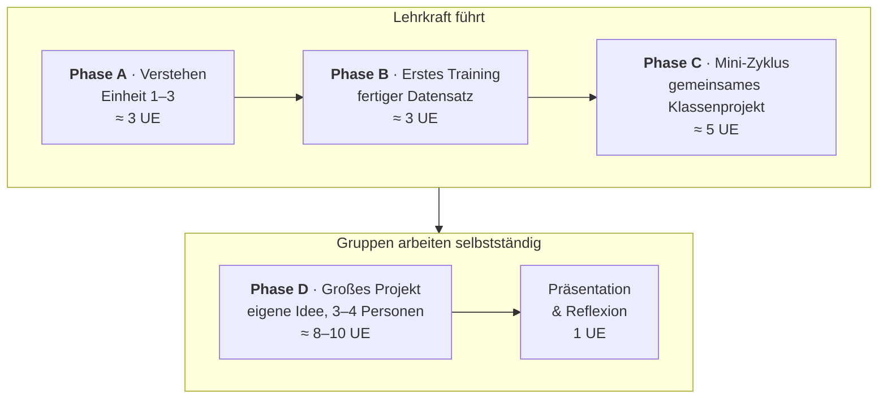
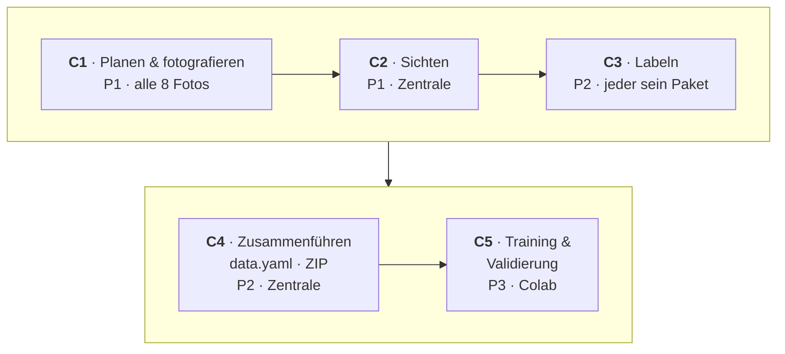

# Leitfaden für Lehrkräfte

Dieser Leitfaden beschreibt, wie du den Kurs mit einer Klasse durchführst: vom ersten Aha-Erlebnis bis zum
selbstständigen Gruppenprojekt. Die Zeitangaben sind in **UE** (Unterrichtseinheiten à 45 min) angegeben und für eine Klasse
mit 20–25 Personen gedacht.

## Der Kurs auf einen Blick

| Phase | Ziel | Wer steuert? | Ergebnis |
|---|---|---|---|
| **A · Verstehen** | Begriffe und Ablauf eines Trainings kennen | Lehrkraft | Grundwissen, uv installiert |
| **B · Erstes Training** | einmal erleben, dass Training funktioniert, und Kennzahlen lesen | Lehrkraft, Paare trainieren | eigenes Wildlife-Modell, Klassen-Experiment |
| **C · Mini-Zyklus** | den **ganzen Zyklus** einmal gemeinsam durchlaufen: Fotos → Labeln → data.yaml → Training → Validierung | Lehrkraft am Beamer, alle arbeiten zu | ein Klassenmodell, alle kennen P1–P3 |
| **D · Großes Projekt** | den Zyklus **selbstständig** und mit Nachtraining anwenden | Gruppen, Lehrkraft berät | eigenes Modell, Logbuch, Präsentation |

!!! tip "Warum der Mini-Zyklus (Phase C)?"
    Im großen Projekt passieren die meisten Fehler beim **ersten** Durchlauf: falscher Ordner, vergessener Export,
    falsch geteilte Drive-Datei. Wenn die Klasse den Zyklus einmal **gemeinsam und klein** durchläuft, kennen alle
    die Werkzeuge. Im Projekt können sie sich dann auf die Inhalte konzentrieren: gute Bilder, saubere Labels, gezieltes Nachtraining.

## Vor dem Kurs: Vorbereitung

- [ ] **Selbst einmal durchspielen:** [Erstes Training](praxis/erstes-training.md) in Colab und die Projektvorlage mit
      ca. 20 eigenen Fotos durch P1 → P2 → P3. Das dauert etwa 2 Stunden und zeigt dir alle Stolpersteine.
- [ ] **Google-Konten klären:** Colab braucht ein Google-Konto. Kläre, ob die Schülerinnen und Schüler private Konten
      nutzen dürfen oder ob die Schule Konten bereitstellt. Für Datenschutzfragen gilt: Die Fotos im Projekt zeigen
      Bauteile, **keine Personen**.
- [ ] **Laptops prüfen:** Windows-Laptop mit Webcam, ca. 5 GB frei, Installation ohne Admin-Rechte möglich (uv braucht keine).
      macOS und Linux sollten funktionieren, sind aber nicht getestet.
- [ ] **Schul-WLAN:** Die Installation lädt über 1 GB pro Laptop. Gib sie als **Hausaufgabe** auf (siehe
      [Software einrichten](software-einrichten.md)). Lege die [Projektvorlage](downloads/yolo-projekt-vorlage.zip) zusätzlich auf einen USB-Stick.
- [ ] **Objekte für den Mini-Zyklus** in einer Kiste bereitstellen (siehe Phase C), etwa 10–15 Stück pro Klasse.
- [ ] **Ablagekanal festlegen** (Teams, Moodle, USB-Stick), über den JSON-Exporte und Ordner verteilt werden.

!!! warning "GPU-Kontingent schonen"
    Teste das Colab-Training **nicht am Vortag** mit dem Konto, das du im Unterricht am Beamer brauchst. Die kostenlose
    GPU ist begrenzt. Ist das Kontingent aufgebraucht, gibt es für etwa 12–24 Stunden keine GPU.

## Phase A · Verstehen (≈ 3 UE)

| UE | Inhalt | Ablauf im Unterricht | Material |
|---|---|---|---|
| A1 | **Einstieg** | Alle öffnen die [Live-Demo](grundlagen/live-demo.md) mit der Webcam. Auftrag: *„Findet drei Dinge, die die KI falsch erkennt.“* Sammeln und daraus die Leitfrage ableiten: Wie bringt man einer KI **neue** Objekte bei? | Live-Demo, [YOLO & Ultralytics](grundlagen/yolo-ultralytics.md) |
| A2 | **Aufgaben & Modelle** | [Aufgabenarten](grundlagen/aufgaben.md) an Beispielen aus der Elektrotechnik zuordnen, [Modellgrößen](grundlagen/modelle.md) vergleichen. Zum Schluss: [uv installieren](grundlagen/installation-uv.md) und erste Vorhersage lokal | Quiz am Seitenende |
| A3 | **Daten & Ablauf** | [Datensätze](daten/datensaetze.md), [Labeln](daten/labeln.md) mit dem Label-Experiment, [data.yaml](daten/data-yaml.md), [Ablauf](training/ablauf.md), [Parameter](training/parameter.md) | Overfitting-Experiment |

**Hausaufgabe nach A3:** [Software einrichten](software-einrichten.md), Teil 1 und 2 (uv und Projektvorlage).
So ist bis Phase C alles installiert.

## Phase B · Erstes Training mit fertigem Datensatz (≈ 3 UE)

Die Klasse trainiert das Notebook [Erstes Training in Colab](praxis/erstes-training.md) mit dem Datensatz
**African Wildlife** (Büffel, Elefant, Nashorn, Zebra). Er muss nicht gelabelt werden, und das Training dauert 15–20 min.

### B1–B2 · Training starten und Ergebnisse verstehen

| Zeit | Was passiert | Hinweise |
|---|---|---|
| 0–10 min | **Gemeinsam starten:** Notebook öffnen, Laufzeittyp **T4 GPU**, *Kopie in Drive speichern*, Zellen 1–3 ausführen | Am Beamer vormachen. In **Paaren** arbeiten: halbiert die GPU-Last |
| 10–15 min | **Vorher-Test** (Zelle 3) besprechen: Das COCO-Modell hält Nashörner für Elefanten, mit über 90 % Sicherheit | Diskussionsfrage: *„Was heißt das für eine Bauteilprüfung?“* |
| 15 min | **Training starten** (Zelle 4) | Ab jetzt läuft Colab im Hintergrund. Den Tab offen lassen |
| 15–60 min | Seite [Ergebnisse verstehen](training/ergebnisse.md) mit den Experimenten bearbeiten: Loss, IoU, Precision/Recall, mAP | Läuft über die Pause in B2 weiter |
| B2 | **Eigene Ergebnisse deuten:** results.png, Confusion Matrix, Testergebnis pro Klasse. `best.pt` herunterladen | Paare erklären sich gegenseitig ein Diagramm |

### B3 · Klassen-Experiment und Test

1. **Klassen-Experiment** (Tabelle auf der Seite [Erstes Training](praxis/erstes-training.md#klassen-experiment-wer-findet-das-beste-setup)):
   Jedes Paar ändert **genau einen** Parameter. Vorher wird eine Vermutung notiert.
   Die Werte für mAP50, mAP50-95 und Trainingszeit kommen an die Tafel.
2. **Auswertung:** Was bringt mehr, mehr Daten oder ein größeres Modell? Warum ist „ohne Vorwissen“ so schlecht? (Transfer Learning)
3. **Testen mit [Solutions](praxis/solutions.md):** das eigene `best.pt` lokal mit Webcam und Zähllinie auf einem Bild am Beamer
   oder auf dem Handy-Display. Die Tiere werden dafür am Bildschirm gezeigt.

!!! note "Wenn keine GPU zugeteilt wird"
    Paare, die keine GPU bekommen, schließen sich einem anderen Paar an oder trainieren mit `fraction=0.25` auf der CPU.
    Für die Auswertung reicht ein Training pro Tisch. Wichtig ist, dass alle die Diagramme deuten.

## Phase C · Mini-Zyklus: gemeinsames Klassenprojekt (≈ 5 UE)

Jetzt durchläuft die ganze Klasse **einmal gemeinsam** den Zyklus mit eigenen Fotos. Du arbeitest am Beamer auf dem
Laptop, der als **Zentrale** dient. Die Schülerinnen und Schüler liefern Fotos und Labels zu und machen jeden Schritt auf
ihrem eigenen Laptop mit. Es ist dieselbe Arbeitsteilung wie später im Gruppenprojekt, nur mit der Klasse als Gruppe.

**Vorschlag für das Klassenprojekt:** zwei Klassen aus der Elektrotechnik, die man leicht unterscheiden kann,
z. B. `wago_221` und `luesterklemme`. Alternativ zwei Werkzeuge, etwa `seitenschneider` und `abisolierzange`.

| UE | Schritt im Zyklus | Lehrkraft (Zentrale, Beamer) | Schülerinnen und Schüler |
|---|---|---|---|
| **C1** | **Bilder aufnehmen** | Seite [Gute Trainingsbilder](projekt/bilder-aufnehmen.md) gemeinsam (20 min). In P1 den **Steckbrief** ausfüllen: Klassen, Definition, Einsatzort, Erfolgskriterium. Den Aufnahmeplan zeigen | Jede Person macht **8 Fotos** nach Aufnahmeplan (verschiedene Hintergründe, Licht, 1–4 Objekte pro Foto). Ordner `<name>_handy` per Teams/USB an die Zentrale |
| **C2** | **Sichten** | P1 Abschnitt 5–8: Import, Bildbrowser, Katalog, Bilanz. Gemeinsam auffällige Bilder ansehen: Warum zu dunkel, unscharf, doppelt? Dann P2 Abschnitt 2: **Pakete verteilen**. Projektordner ohne `1_rohbilder/` an alle | Ordner lokal entpacken, eigenes Paket finden |
| **C3** | **Labeln** | Label Studio am Beamer einrichten (P2 Abschnitt 3–4) und die **Label-Regeln** festlegen: Box eng anlegen, verdeckte Objekte mitlabeln usw. | Label Studio auf dem eigenen Laptop starten, eigenes Paket labeln (≈ 10 min), **als JSON exportieren** und an die Zentrale schicken |
| **C4** | **data.yaml & Datensatz** | P2 Abschnitt 6–10: Exporte zusammenführen, Konflikte und Fehler live zeigen, Statistik, Ausschnitte pro Klasse. **data.yaml öffnen und besprechen.** Aufteilung train/val/test erklären, ZIP bauen und in Drive laden | Übung **Umrechnen** (P2 Abschnitt 7) selbst lösen. Ausschnitte prüfen: Wer findet eine falsche Box? |
| **C5** | **Training & Validierung** | P3 in Colab am Beamer: `EPOCHEN = 50`, Training starten (≈ 10–15 min). Danach Abschnitt 6: Lernkurven, Tabelle pro Klasse, Confusion Matrix, Fehleranalyse | Während des Trainings: [P3-Seite](projekt/p3-training.md) lesen. Danach in Paaren das **Diagnose-Blatt** ausfüllen: Was ist der häufigste Fehler? Was würden wir nachtrainieren? |

**Abschluss von C5 (15 min):** Das Klassenmodell live mit der Webcam testen, mit dem Befehl, den P3 in Abschnitt 7 ausgibt.
Danach gemeinsam überlegen: *„Was müssten wir für Runde 2 ändern?“* Ein Blick auf die Seite [Nachtraining](projekt/nachtraining.md)
reicht hier. Durchgeführt wird das Nachtraining erst im großen Projekt.

!!! tip "So bleibt der Mini-Zyklus schnell"
    - 2 Klassen, 8 Fotos pro Person: bei 24 Personen etwa 190 Fotos. Das reicht für ein brauchbares Modell.
    - Die Labelarbeit ist auf alle verteilt: etwa 8 Bilder pro Person.
    - Das ZIP lädst **du** in **dein** Drive hoch. So brauchen die Schülerinnen und Schüler in C5 kein Google-Konto.
    - Jeder Fehler, der am Beamer passiert (fehlender Export, falsche Klasse, gedrehtes Bild), ist ein **Lernanlass**.
      P2 meldet solche Fehler mit verständlichen Hinweisen. Zeige sie, statt sie heimlich zu beheben.

## Phase D · Das große Projekt (≈ 8–10 UE)

Jetzt arbeiten **Gruppen mit 3–4 Personen** an einer eigenen Idee. Du wechselst von der Vorführrolle in die **Beratung**.
Alles, was die Gruppen brauchen, steht auf der Seite [Eigenes Projekt](projekt/index.md): Ideen, Rollen, Arbeitsteilung und Abgabe.

### Start (1 UE)

1. **Gruppen bilden** und **Rollen verteilen**: Projektleitung, Fotografie, Qualität, Training
   (siehe [Rollen](projekt/index.md#rollen)). Die Projektleitung braucht den zuverlässigsten Laptop.
2. **Idee wählen** aus den [Projektideen](projekt/index.md#projektideen-aus-der-elektrotechnik) oder eine eigene.
3. **Steckbrief in P1 ausfüllen** und **von dir freigeben lassen**. Prüfe dabei:
    - Sind es **2–4 Klassen**, die man mit bloßem Auge unterscheiden kann?
    - Hat jede Klasse eine klare **Definition** (Was zählt dazu, was nicht)?
    - Ist das **Erfolgskriterium** messbar, z. B. „mAP50 ≥ 0,8 pro Klasse und 9 von 10 Objekten im Webcam-Test“?
    - Ist der Aufwand realistisch? Faustregel: 150–300 Objekte pro Klasse.

### Meilensteine mit Kontrollpunkten

| Meilenstein | UE | Notebook | Kontrollpunkt (kurz bei dir vorzeigen) |
|---|---|---|---|
| Steckbrief & Aufnahmeplan | D1 | P1 Abschnitt 1–3 | Freigabe des Steckbriefs |
| Fotos gesammelt und gesichtet | D2–D3 | P1 Abschnitt 4–8 | **Bilanz**: Objekte pro Klasse, Hintergründe, Aussortiertes |
| Gelabelt | D3–D5 | P2 Abschnitt 2–5 | alle JSON-Exporte bei der Projektleitung |
| Datensatz v1 | D5 | P2 Abschnitt 6–10 | **Statistik** und Ausschnitte pro Klasse, data.yaml |
| Modell v1 bewertet | D6 | P3 | **Diagnose-Blatt**: häufigster Fehler und Hypothese |
| Nachtraining | D7–D8 | P1 → P2 → P3 | **Versions-Logbuch** mit fairem Vergleich v1 ↔ v2 |
| Abschlusstest | D8 | P3 Abschnitt 10 | Testergebnis (wird nur **einmal** ausgeführt) |
| Präsentation | D9 | – | Live-Vorführung, Reflexion |

Fotografieren und Labeln laufen zum Teil als **Hausaufgabe**. Plane das bei der Zeitrechnung ein.

### Deine Rolle während der Projektphase

- **Stundeneinstieg (5 min):** Jede Gruppe sagt in einem Satz, wo sie steht und was heute ihr Ziel ist.
- **Kontrollpunkte abnehmen:** Die Gruppen kommen zu dir, wenn ein Meilenstein erreicht ist.
- **Bei Problemen zuerst fragen:** *„Was sagt die Fehlermeldung im Notebook?“* Die Notebooks erklären die meisten Fehler selbst.
- **Nachtraining begleiten:** Achte darauf, dass jede Gruppe eine **Hypothese** formuliert, bevor sie nachtrainiert, und
  dass sie **nur eine Sache** ändert (siehe [Nachtraining](projekt/nachtraining.md)).
- **Den Abschlusstest schützen:** Die Testbilder werden erst ganz am Ende verwendet. Wer vorher darauf optimiert,
  misst nichts mehr.

### Typische Probleme in der Projektphase

| Problem | Ursache | Hilfe |
|---|---|---|
| Modell ist im Webcam-Test viel schlechter als in den Kennzahlen | Fotos nur mit Handy, Einsatz mit Webcam; immer derselbe Hintergrund | Seite [Gute Trainingsbilder](projekt/bilder-aufnehmen.md), Aufnahmeplan prüfen |
| Eine Klasse ist schlecht | zu wenige Objekte oder unklare Definition | Statistik in P2; Definition schärfen und nachlabeln |
| Labeln dauert zu lange | zu viele Klassen oder Bilder geplant | Klassen reduzieren, Labeln als Hausaufgabe |
| Keine GPU in Colab | Kontingent aufgebraucht | anderes Konto aus der Gruppe; P3 setzt nach Abbruch fort |
| Gruppenmitglied hat Exporte vergessen | Arbeitsteilung unklar | Gruppen-Ablauf auf [Eigenes Projekt](projekt/index.md#wer-macht-was-auf-welchem-laptop) |

## Bewertungsvorschlag

| Bereich | Anteil | Woran erkennbar |
|---|---|---|
| **Planung** | 15 % | Steckbrief mit klaren Klassendefinitionen und messbarem Erfolgskriterium, Aufnahmeplan |
| **Datenqualität** | 25 % | Vielfalt der Bilder, saubere Labels (Ausschnitte), ausgewogene Klassen |
| **Training & Auswertung** | 20 % | richtige Deutung von Lernkurven, Confusion Matrix und Fehleranalyse |
| **Nachtraining** | 20 % | begründete Hypothese, fairer Vergleich, Versions-Logbuch |
| **Präsentation & Reflexion** | 20 % | Live-Vorführung, ehrliche Bewertung: Wo ist das Modell gut, wo nicht, und warum? |

Ein Modell, das das Erfolgskriterium **nicht** erreicht, kann trotzdem sehr gut bewertet werden, wenn die Gruppe nachvollziehbar
erklärt, woran es liegt und was sie als Nächstes tun würde.

## Checkliste vor jeder Praxisstunde

- [ ] Beamer-Laptop: Projektordner, JupyterLab und Label Studio laufen
- [ ] Colab-Konto für den Beamer hat heute noch keine GPU verbraucht
- [ ] USB-Stick mit der [Projektvorlage](downloads/yolo-projekt-vorlage.zip) für Nachzügler
- [ ] Ablagekanal (Teams/Moodle) für Fotos und JSON-Exporte ist angelegt
- [ ] Objekte bzw. Projektmaterial der Gruppen liegt bereit
