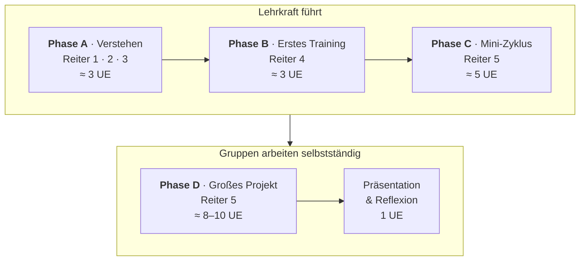
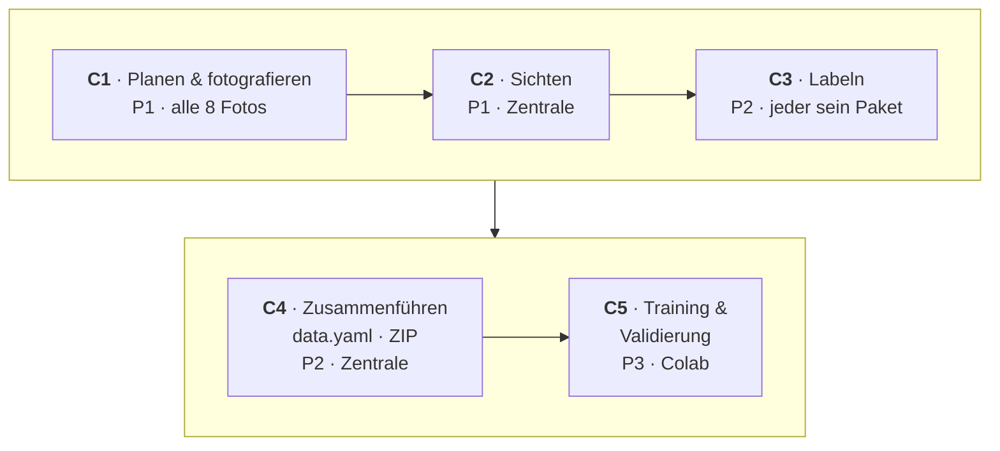

# Leitfaden für Lehrkräfte

Dieser Leitfaden beschreibt, wie du den Kurs mit einer Klasse durchführst: vom ersten Aha-Erlebnis bis zum
selbstständigen Gruppenprojekt. Bei **jedem Schritt** steht, **wo** du das Material auf der Lernseite findest.
Die Zeitangaben sind in **UE** (Unterrichtseinheiten à 45 min) angegeben und für eine Klasse mit 20–25 Personen gedacht.

## So findest du dich auf der Lernseite zurecht

Auf der Lernseite gibt es drei Ebenen. Im Leitfaden steht jede Fundstelle als Pfad
**Reiter › Seite › Abschnitt**, z. B. **4 · Praxis › Erstes Training in Colab › Schritt für Schritt**.

| Ebene | Wo auf dem Bildschirm | Beispiel |
|---|---|---|
| **Reiter** = Einheit | blaue Leiste **oben**, unter dem Titel | `1 · Grundlagen`, `4 · Praxis`, `5 · Projekt` |
| **Seite** | Liste **links** | `Erstes Training in Colab` |
| **Abschnitt** | Liste **rechts**: „Auf dieser Seite“ | `Schritt für Schritt` |

!!! tip "Keine Reiter oben zu sehen?"
    Bei schmalem Browserfenster klappt die Seite die Menüs ein. Dann öffnest du sie mit **☰** oben links.
    Schneller geht es oft mit der **Suche** (Lupe oben rechts): Seitentitel oder Stichwort eintippen.

**Alles Material liegt auf der Lernseite.** Das [GitHub-Repository](https://github.com/rdf-sul/YOLO_Training) ist
nur die Quelle, aus der die Seite gebaut wird. Du brauchst es im Unterricht nicht. Notebooks öffnest du über die Knöpfe
auf der Lernseite (Colab) oder über die Projektvorlage (ZIP).

## Der Kurs auf einen Blick

## Wegweiser: Wo finde ich was?

| Phase | Reiter oben | Seiten (links) | Notebook / Download |
|---|---|---|---|
| Vorbereitung | **Start** | [Software einrichten](software-einrichten.md), [Lernpfad & Zeitplan](lernpfad.md) | [Projektvorlage (ZIP)](downloads/yolo-projekt-vorlage.zip) |
| **A · Verstehen** | **1 · Grundlagen** | [Live-Demo im Browser](grundlagen/live-demo.md), [YOLO & Ultralytics](grundlagen/yolo-ultralytics.md), [Aufgabenarten](grundlagen/aufgaben.md), [Welches Modell?](grundlagen/modelle.md), [Installation mit uv](grundlagen/installation-uv.md) | – |
| | **2 · Daten** | [Datensätze finden](daten/datensaetze.md), [Daten labeln](daten/labeln.md), [Die data.yaml](daten/data-yaml.md) | – |
| | **3 · Training** | [Ablauf eines Trainings](training/ablauf.md), [Parameter einstellen](training/parameter.md), [Ergebnisse verstehen](training/ergebnisse.md) | – |
| **B · Erstes Training** | **4 · Praxis** | [Erstes Training in Colab](praxis/erstes-training.md), [Modell testen mit Solutions](praxis/solutions.md) | [Notebook „Erstes Training“ in Colab](https://colab.research.google.com/github/rdf-sul/YOLO_Training/blob/main/notebooks/01_erstes_training.ipynb) |
| **C · Mini-Zyklus** | **5 · Projekt** | [Gute Trainingsbilder](projekt/bilder-aufnehmen.md), [P1 · Daten sammeln](projekt/p1-daten-sammeln.md), [P2 · Labeln und prüfen](projekt/p2-labeln.md), [P3 · Training in Colab](projekt/p3-training.md) | P1 und P2 aus der [Projektvorlage](downloads/yolo-projekt-vorlage.zip), [P3 in Colab](https://colab.research.google.com/github/rdf-sul/YOLO_Training/blob/main/projekt-vorlage/P3_training_colab.ipynb) |
| **D · Großes Projekt** | **5 · Projekt** | [Eigenes Projekt](projekt/index.md) (Übersicht: Ideen, Gruppen, Rollen, Abgabe), [Nachtraining](projekt/nachtraining.md) | wie Phase C |
| Nachschlagen | **Glossar** | [Glossar](glossar.md) | – |

Die Begleitseiten P1–P3 tragen **dieselben Abschnittsnummern wie die Notebooks**. „P2 Abschnitt 7“ ist also im Notebook
und auf der Seite **5 · Projekt › P2 · Labeln und prüfen** dieselbe Stelle.

## Vor dem Kurs: Vorbereitung

- [ ] **Selbst einmal durchspielen:** **4 · Praxis › [Erstes Training in Colab](praxis/erstes-training.md)** und die
      [Projektvorlage](downloads/yolo-projekt-vorlage.zip) mit ca. 20 eigenen Fotos durch P1 → P2 → P3.
      Das dauert etwa 2 Stunden und zeigt dir alle Stolpersteine.
- [ ] **Google-Konten klären:** Colab braucht ein Google-Konto. Kläre, ob die Schülerinnen und Schüler private Konten
      nutzen dürfen oder ob die Schule Konten bereitstellt. Die Fotos im Projekt zeigen Bauteile, **keine Personen**.
- [ ] **Laptops prüfen:** Windows-Laptop mit Webcam, ca. 5 GB frei. Admin-Rechte sind nicht nötig.
      macOS und Linux sollten funktionieren, sind aber nicht getestet.
- [ ] **Installation als Hausaufgabe:** Schicke den Link auf **Start › [Software einrichten](software-einrichten.md)**.
      Lege die [Projektvorlage](downloads/yolo-projekt-vorlage.zip) zusätzlich auf einen USB-Stick.
- [ ] **Objekte für den Mini-Zyklus** in einer Kiste bereitstellen (siehe Phase C), etwa 10–15 Stück pro Klasse.
- [ ] **Ablagekanal festlegen** (Teams, Moodle, USB-Stick), über den Fotos, JSON-Exporte und Ordner verteilt werden.

!!! warning "GPU-Kontingent schonen"
    Teste das Colab-Training **nicht am Vortag** mit dem Konto, das du im Unterricht am Beamer brauchst. Die kostenlose
    GPU ist begrenzt. Ist das Kontingent aufgebraucht, gibt es für etwa 12–24 Stunden keine GPU.

## Phase A · Verstehen (≈ 3 UE)

!!! info "📍 Reiter 1 · Grundlagen, 2 · Daten, 3 · Training"

| UE | Inhalt | Ablauf im Unterricht | 📍 Wo? |
|---|---|---|---|
| A1 | **Einstieg** | Alle öffnen die Live-Demo mit der Webcam. Auftrag: *„Findet drei Dinge, die die KI falsch erkennt.“* Sammeln und daraus die Leitfrage ableiten: Wie bringt man einer KI **neue** Objekte bei? | **1 · Grundlagen** › [Live-Demo im Browser](grundlagen/live-demo.md), dann [YOLO & Ultralytics](grundlagen/yolo-ultralytics.md) |
| A2 | **Aufgaben & Modelle** | Aufgabenarten an Beispielen aus der Elektrotechnik zuordnen, Modellgrößen vergleichen. Zum Schluss uv installieren und erste Vorhersage lokal | **1 · Grundlagen** › [Aufgabenarten](grundlagen/aufgaben.md), [Welches Modell?](grundlagen/modelle.md), [Installation mit uv](grundlagen/installation-uv.md) |
| A3 | **Daten & Ablauf** | Label-Experiment, data.yaml lesen, Ablauf und Parameter, Overfitting-Experiment | **2 · Daten** › [Daten labeln](daten/labeln.md), [Die data.yaml](daten/data-yaml.md); **3 · Training** › [Ablauf](training/ablauf.md), [Parameter](training/parameter.md) |

Am Ende jeder Seite steht ein **Kurz-Check** (Quiz) zur Sicherung.

**Hausaufgabe nach A3:** **Start › [Software einrichten](software-einrichten.md)**, Teil 1 und 2.
So ist bis Phase C alles installiert.

## Phase B · Erstes Training mit fertigem Datensatz (≈ 3 UE)

!!! info "📍 Reiter 4 · Praxis › Erstes Training in Colab"
    Notebook: Knopf **Notebook in Colab öffnen** auf der Seite [Erstes Training in Colab](praxis/erstes-training.md#los-gehts)
    oder direkt [in Colab öffnen](https://colab.research.google.com/github/rdf-sul/YOLO_Training/blob/main/notebooks/01_erstes_training.ipynb).

Die Klasse trainiert mit dem Datensatz **African Wildlife** (Büffel, Elefant, Nashorn, Zebra).
Er muss nicht gelabelt werden, und das Training dauert 15–20 min.

### B1–B2 · Training starten und Ergebnisse verstehen

| Zeit | Was passiert | 📍 Wo? |
|---|---|---|
| 0–10 min | **Gemeinsam starten:** Notebook öffnen, *Kopie in Drive speichern*, Laufzeittyp **T4 GPU**, Zellen 1–3 ausführen. Am Beamer vormachen. In **Paaren** arbeiten: halbiert die GPU-Last | **4 · Praxis** › Erstes Training in Colab › [Schritt für Schritt](praxis/erstes-training.md#schritt-fur-schritt) |
| 10–15 min | **Vorher-Test** (Zelle 3) besprechen: Das Startmodell hält Nashörner für Elefanten, mit über 90 % Sicherheit. *„Was heißt das für eine Bauteilprüfung?“* | **4 · Praxis** › Erstes Training in Colab › [Was du erwarten kannst](praxis/erstes-training.md#was-du-erwarten-kannst) |
| 15 min | **Training starten** (Zelle 4). Colab läuft im Hintergrund weiter, Tab offen lassen | im Notebook |
| 15–60 min | Seite „Ergebnisse verstehen“ mit den Experimenten bearbeiten: Loss, IoU, Precision/Recall, mAP | **3 · Training** › [Ergebnisse verstehen](training/ergebnisse.md) |
| B2 | **Eigene Ergebnisse deuten:** results.png, Confusion Matrix, Testergebnis pro Klasse, `best.pt` herunterladen. Paare erklären sich gegenseitig ein Diagramm | im Notebook, Abschnitt 5–8 |

### B3 · Klassen-Experiment und Test

| Schritt | Was passiert | 📍 Wo? |
|---|---|---|
| 1 | **Klassen-Experiment:** Jedes Paar ändert **genau einen** Parameter, notiert vorher eine Vermutung. mAP50, mAP50-95 und Trainingszeit an die Tafel | **4 · Praxis** › Erstes Training in Colab › [Klassen-Experiment](praxis/erstes-training.md#klassen-experiment-wer-findet-das-beste-setup) |
| 2 | **Auswertung:** Was bringt mehr, mehr Daten oder ein größeres Modell? Warum ist „ohne Vorwissen“ so schlecht? (Transfer Learning) | Tafel |
| 3 | **Testen:** das eigene `best.pt` lokal mit Webcam und Zähllinie. Die Tiere werden dafür am Bildschirm oder Handy gezeigt | **4 · Praxis** › [Modell testen mit Solutions](praxis/solutions.md) |

!!! note "Wenn keine GPU zugeteilt wird"
    Paare, die keine GPU bekommen, schließen sich einem anderen Paar an. Für die Auswertung reicht ein Training pro Tisch.
    Wichtig ist, dass alle die Diagramme deuten.

## Phase C · Mini-Zyklus: gemeinsames Klassenprojekt (≈ 5 UE)

!!! info "📍 Reiter 5 · Projekt › Gute Trainingsbilder, P1, P2, P3"
    - **P1 und P2** laufen lokal aus der [Projektvorlage (ZIP)](downloads/yolo-projekt-vorlage.zip). Start mit `uv run jupyter lab`,
      siehe **Start › [Software einrichten › Lokal arbeiten](software-einrichten.md#3-lokal-arbeiten-p1-und-p2)**.
    - **P3** läuft in Colab: [P3 in Colab öffnen](https://colab.research.google.com/github/rdf-sul/YOLO_Training/blob/main/projekt-vorlage/P3_training_colab.ipynb).

Jetzt durchläuft die ganze Klasse **einmal gemeinsam** den Zyklus mit eigenen Fotos. Du arbeitest am Beamer auf dem
Laptop, der als **Zentrale** dient. Die Schülerinnen und Schüler liefern Fotos und Labels zu und machen jeden Schritt auf
ihrem eigenen Laptop mit. Es ist dieselbe Arbeitsteilung wie später im Gruppenprojekt, nur mit der Klasse als Gruppe.

**Vorschlag für das Klassenprojekt:** zwei Klassen aus der Elektrotechnik, die man leicht unterscheiden kann,
z. B. `wago_221` und `luesterklemme`. Alternativ zwei Werkzeuge, etwa `seitenschneider` und `abisolierzange`.

| UE | Schritt | Lehrkraft (Zentrale, Beamer) | Schülerinnen und Schüler | 📍 Wo? |
|---|---|---|---|---|
| **C1** | **Bilder aufnehmen** | Seite „Gute Trainingsbilder“ gemeinsam (20 min). In P1 den **Steckbrief** ausfüllen: Klassen, Definition, Einsatzort, Erfolgskriterium. Aufnahmeplan zeigen | Jede Person macht **8 Fotos** nach Aufnahmeplan (verschiedene Hintergründe, Licht, 1–4 Objekte pro Foto). Ordner `<name>_handy` an die Zentrale | **5 · Projekt** › [Gute Trainingsbilder](projekt/bilder-aufnehmen.md); [P1](projekt/p1-daten-sammeln.md) Abschnitt 2–4 |
| **C2** | **Sichten** | P1 Abschnitt 5–8: Import, Bildbrowser, Katalog, Bilanz. Auffällige Bilder besprechen. Dann P2 Abschnitt 2: **Pakete verteilen**. Projektordner ohne `1_rohbilder/` an alle | Ordner lokal entpacken, eigenes Paket finden | **5 · Projekt** › [P1 · Daten sammeln › 6–8](projekt/p1-daten-sammeln.md#68-sichten-katalog-und-bilanz) |
| **C3** | **Labeln** | Label Studio am Beamer einrichten und die **Label-Regeln** festlegen: Box eng anlegen, verdeckte Objekte mitlabeln usw. | Label Studio auf dem eigenen Laptop starten, eigenes Paket labeln (≈ 10 min), **als JSON exportieren** und an die Zentrale schicken | **5 · Projekt** › [P2 › 3–4 Label Studio](projekt/p2-labeln.md#34-label-studio-mit-lokalem-ordner), [P2 › 5 Exportieren](projekt/p2-labeln.md#5-exportieren-warum-json-und-nicht-yolo) |
| **C4** | **data.yaml & Datensatz** | P2 Abschnitt 6–10: Exporte zusammenführen, Fehler live zeigen, Statistik, Ausschnitte pro Klasse. **data.yaml öffnen und besprechen.** Aufteilung erklären, ZIP bauen und in **dein** Drive laden | Übung **Umrechnen** (P2 Abschnitt 7) selbst lösen. Ausschnitte prüfen: Wer findet eine falsche Box? | **5 · Projekt** › [P2 › 6 Zusammenführen](projekt/p2-labeln.md#6-zusammenfuhren-und-prufen) bis [10 Probelauf und Upload](projekt/p2-labeln.md#10-probelauf-und-upload) |
| **C5** | **Training & Validierung** | P3 in Colab am Beamer: `EPOCHEN = 50`, Training starten (≈ 10–15 min). Danach Abschnitt 6: Lernkurven, Tabelle pro Klasse, Confusion Matrix, Fehleranalyse | Während des Trainings die P3-Seite lesen. Danach in Paaren das **Diagnose-Blatt** ausfüllen: Was ist der häufigste Fehler? | **5 · Projekt** › [P3 · Training in Colab](projekt/p3-training.md), Abschnitt [6 · Auswerten](projekt/p3-training.md#6-auswerten) |

**Abschluss von C5 (15 min):** Das Klassenmodell live mit der Webcam testen, mit dem Befehl, den P3 in Abschnitt 7 ausgibt.
Danach gemeinsam überlegen: *„Was müssten wir für Runde 2 ändern?“* Ein Blick auf **5 · Projekt ›
[Nachtraining](projekt/nachtraining.md)** reicht hier. Durchgeführt wird das Nachtraining erst im großen Projekt.

!!! tip "So bleibt der Mini-Zyklus schnell"
    - 2 Klassen, 8 Fotos pro Person: bei 24 Personen etwa 190 Fotos. Das reicht für ein brauchbares Modell.
    - Die Labelarbeit ist auf alle verteilt: etwa 8 Bilder pro Person.
    - Das ZIP lädst **du** in **dein** Drive hoch. So brauchen die Schülerinnen und Schüler in C5 kein Google-Konto.
    - Jeder Fehler, der am Beamer passiert (fehlender Export, falsche Klasse, gedrehtes Bild), ist ein **Lernanlass**.
      P2 meldet solche Fehler mit verständlichen Hinweisen. Zeige sie, statt sie heimlich zu beheben.

## Phase D · Das große Projekt (≈ 8–10 UE)

!!! info "📍 Reiter 5 · Projekt › Eigenes Projekt (erste Seite des Reiters) und Nachtraining"
    Die Seite [Eigenes Projekt](projekt/index.md) ist die Anlaufstelle für die Gruppen. Rechts unter „Auf dieser Seite“
    findest du: Projektvorlage einrichten, Projektideen, Wann ist das Projekt fertig?, Arbeiten in der Gruppe, Rollen,
    Was du am Ende abgibst.

Jetzt arbeiten **Gruppen mit 3–4 Personen** an einer eigenen Idee. Du wechselst von der Vorführrolle in die **Beratung**.

### Start (1 UE)

| Schritt | Was passiert | 📍 Wo? |
|---|---|---|
| 1 | **Gruppen bilden** und **Rollen verteilen**: Projektleitung, Fotografie, Qualität, Training. Die Projektleitung braucht den zuverlässigsten Laptop | **5 · Projekt** › Eigenes Projekt › [Rollen](projekt/index.md#rollen), [Wer macht was?](projekt/index.md#wer-macht-was-auf-welchem-laptop) |
| 2 | **Idee wählen** aus der Liste oder eine eigene | **5 · Projekt** › Eigenes Projekt › [Projektideen](projekt/index.md#projektideen-aus-der-elektrotechnik) |
| 3 | **Steckbrief in P1 ausfüllen** und **von dir freigeben lassen** (Prüffragen unten) | **5 · Projekt** › [P1 › 2 Steckbrief](projekt/p1-daten-sammeln.md#2-der-projekt-steckbrief), [Wann ist das Projekt fertig?](projekt/index.md#wann-ist-das-projekt-fertig) |

**Prüffragen für die Freigabe des Steckbriefs:**

- Sind es **2–4 Klassen**, die man mit bloßem Auge unterscheiden kann?
- Hat jede Klasse eine klare **Definition** (Was zählt dazu, was nicht)?
- Ist das **Erfolgskriterium** messbar, z. B. „mAP50 ≥ 0,8 pro Klasse und 9 von 10 Objekten im Webcam-Test“?
- Ist der Aufwand realistisch? Faustregel: 150–300 Objekte pro Klasse.

### Meilensteine mit Kontrollpunkten

| Meilenstein | UE | Notebook | Kontrollpunkt (kurz bei dir vorzeigen) | 📍 Wo? (Reiter 5 · Projekt) |
|---|---|---|---|---|
| Steckbrief & Aufnahmeplan | D1 | P1 Abschnitt 1–3 | Freigabe des Steckbriefs | [P1](projekt/p1-daten-sammeln.md), [Gute Trainingsbilder](projekt/bilder-aufnehmen.md) |
| Fotos gesammelt und gesichtet | D2–D3 | P1 Abschnitt 4–8 | **Bilanz**: Objekte pro Klasse, Hintergründe, Aussortiertes | [P1 › 6–8](projekt/p1-daten-sammeln.md#68-sichten-katalog-und-bilanz) |
| Gelabelt | D3–D5 | P2 Abschnitt 2–5 | alle JSON-Exporte bei der Projektleitung | [P2 › 3–4](projekt/p2-labeln.md#34-label-studio-mit-lokalem-ordner) |
| Datensatz v1 | D5 | P2 Abschnitt 6–10 | **Statistik** und Ausschnitte pro Klasse, data.yaml | [P2 › 6–10](projekt/p2-labeln.md#6-zusammenfuhren-und-prufen) |
| Modell v1 bewertet | D6 | P3 | **Diagnose-Blatt**: häufigster Fehler und Hypothese | [P3 › 6 Auswerten](projekt/p3-training.md#6-auswerten) |
| Nachtraining | D7–D8 | P1 → P2 → P3 | **Versions-Logbuch** mit fairem Vergleich v1 ↔ v2 | [Nachtraining](projekt/nachtraining.md) |
| Abschlusstest | D8 | P3 Abschnitt 10 | Testergebnis (wird nur **einmal** ausgeführt) | [P3 › 9–10](projekt/p3-training.md#910-vergleich-und-abschlusstest) |
| Präsentation | D9 | – | Live-Vorführung, Reflexion | [Was du am Ende abgibst](projekt/index.md#was-du-am-ende-abgibst) |

Fotografieren und Labeln laufen zum Teil als **Hausaufgabe**. Plane das bei der Zeitrechnung ein.

### Deine Rolle während der Projektphase

- **Stundeneinstieg (5 min):** Jede Gruppe sagt in einem Satz, wo sie steht und was heute ihr Ziel ist.
- **Kontrollpunkte abnehmen:** Die Gruppen kommen zu dir, wenn ein Meilenstein erreicht ist.
- **Bei Problemen zuerst fragen:** *„Was sagt die Fehlermeldung im Notebook?“* Die Notebooks erklären die meisten Fehler selbst.
- **Nachtraining begleiten:** Achte darauf, dass jede Gruppe eine **Hypothese** formuliert, bevor sie nachtrainiert, und
  dass sie **nur eine Sache** ändert.
- **Den Abschlusstest schützen:** Die Testbilder werden erst ganz am Ende verwendet. Wer vorher darauf optimiert,
  misst nichts mehr.

### Typische Probleme in der Projektphase

| Problem | Ursache | 📍 Hilfe |
|---|---|---|
| Modell ist im Webcam-Test viel schlechter als in den Kennzahlen | Fotos nur mit Handy, Einsatz mit Webcam; immer derselbe Hintergrund | **5 · Projekt** › [Gute Trainingsbilder](projekt/bilder-aufnehmen.md) |
| Eine Klasse ist schlecht | zu wenige Objekte oder unklare Definition | **5 · Projekt** › [Nachtraining](projekt/nachtraining.md) |
| Labeln dauert zu lange | zu viele Klassen oder Bilder geplant | Klassen reduzieren, Labeln als Hausaufgabe |
| Keine GPU in Colab | Kontingent aufgebraucht | **5 · Projekt** › P3 › [Keine GPU verfügbar?](projekt/p3-training.md#keine-gpu-verfugbar) |
| Installation oder Label Studio klemmt | – | **Start** › Software einrichten › [Wenn etwas nicht klappt](software-einrichten.md#wenn-etwas-nicht-klappt) |
| Gruppenmitglied hat Exporte vergessen | Arbeitsteilung unklar | **5 · Projekt** › Eigenes Projekt › [Wer macht was?](projekt/index.md#wer-macht-was-auf-welchem-laptop) |

## Bewertungsvorschlag

| Bereich | Anteil | Woran erkennbar |
|---|---|---|
| **Planung** | 15 % | Steckbrief mit klaren Klassendefinitionen und messbarem Erfolgskriterium, Aufnahmeplan |
| **Datenqualität** | 25 % | Vielfalt der Bilder, saubere Labels (Ausschnitte), ausgewogene Klassen |
| **Training & Auswertung** | 20 % | richtige Deutung von Lernkurven, Confusion Matrix und Fehleranalyse |
| **Nachtraining** | 20 % | begründete Hypothese, fairer Vergleich, Versions-Logbuch |
| **Präsentation & Reflexion** | 20 % | Live-Vorführung, ehrliche Bewertung: Wo ist das Modell gut, wo nicht, und warum? |

Ein Modell, das das Erfolgskriterium **nicht** erreicht, kann trotzdem sehr gut bewertet werden, wenn die Gruppe nachvollziehbar
erklärt, woran es liegt und was sie als Nächstes tun würde.

## Checkliste vor jeder Praxisstunde

- [ ] Beamer-Laptop: Projektordner, JupyterLab und Label Studio laufen
- [ ] Colab-Konto für den Beamer hat heute noch keine GPU verbraucht
- [ ] USB-Stick mit der [Projektvorlage](downloads/yolo-projekt-vorlage.zip) für Nachzügler
- [ ] Ablagekanal (Teams/Moodle) für Fotos und JSON-Exporte ist angelegt
- [ ] Objekte bzw. Projektmaterial der Gruppen liegt bereit
