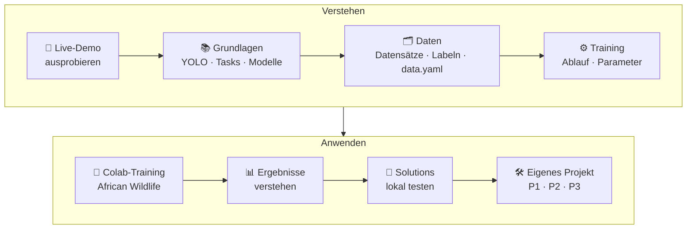

# Lernpfad & Zeitplan

Der Kurs ist für **ca. 4–6 Unterrichtseinheiten (à 45 min)** gedacht. Weil das knapp ist, hat jede Seite einen
**Kernteil** (Pflicht) und aufklappbare **Vertiefungen** (optional, für Schnelle oder zum Nacharbeiten).

## Vorschlag für den Ablauf

| UE | Thema | Seiten | Aktivität |
|---|---|---|---|
| 1 | **Einstieg & Grundbegriffe** | [Live-Demo](grundlagen/live-demo.md), [YOLO & Ultralytics](grundlagen/yolo-ultralytics.md), [Aufgabenarten](grundlagen/aufgaben.md) | Webcam-Demo, NMS-Experiment, Quiz |
| 2 | **Modelle & Werkzeuge** | [Welches Modell?](grundlagen/modelle.md), [Installation mit uv](grundlagen/installation-uv.md) | uv installieren, erste Vorhersage lokal |
| 3 | **Daten & Ablauf** | [Datensätze](daten/datensaetze.md), [Labeln](daten/labeln.md), [data.yaml](daten/data-yaml.md), [Ablauf](training/ablauf.md), [Parameter](training/parameter.md) | Label-Experiment, Overfitting-Experiment |
| 4–5 | **Erstes Training** | [Erstes Training in Colab](praxis/erstes-training.md), währenddessen [Ergebnisse verstehen](training/ergebnisse.md) | Training starten → während es läuft: IoU- und Precision/Recall-Experimente |
| 6 | **Testen & Anwenden** | [Solutions](praxis/solutions.md) | Eigenes Modell mit Webcam testen, Objekte zählen |

### Danach: das eigene Projekt (Einheit 5)

Das Projekt braucht zusätzlich etwa **6–10 UE**, je nach Umfang und wie viel zu Hause fotografiert und gelabelt wird.

| UE | Phase | Seiten / Notebook | Ergebnis |
|---|---|---|---|
| P-1 | **Planen** | [Gute Trainingsbilder](projekt/bilder-aufnehmen.md), [P1](projekt/p1-daten-sammeln.md) Abschnitt 1–3 | Steckbrief, Aufnahmeplan |
| P-2 | **Fotografieren & sichten** | P1 Abschnitt 4–8 | geprüfte Bilder in `2_bilder/` |
| P-3/4 | **Labeln** | [P2](projekt/p2-labeln.md) Abschnitt 1–5 | JSON-Exporte |
| P-5 | **Prüfen & Datensatz bauen** | P2 Abschnitt 6–10 | `datensatz_v1.zip` in Drive |
| P-6 | **Trainieren & auswerten** | [P3](projekt/p3-training.md) | Modell, Kennzahlen, Fehleranalyse |
| P-7/8 | **Nachtraining** | [Nachtraining](projekt/nachtraining.md) | `datensatz_v2`, fairer Vergleich |
| P-9 | **Präsentieren** | [Projekt-Abgabe](projekt/index.md#was-du-am-ende-abgibst) | Live-Demo, Logbuch, Reflexion |

!!! tip "Zeit sparen: Training läuft – du lernst weiter"
    Das Colab-Training dauert ca. 15–25 Minuten. Starte es **zu Beginn** der Einheit und bearbeite in der Zwischenzeit
    die Seite [Ergebnisse verstehen](training/ergebnisse.md). Wenn das Training fertig ist, kannst du deine eigenen
    Diagramme sofort deuten.

## Lernziele

Am Ende kannst du …

- [ ] erklären, was ein YOLO-Modell ist und warum es „You Only Look Once“ heißt,
- [ ] die Aufgabenarten **Klassifikation, Detektion, Segmentierung (Instanz/semantisch), Pose und OBB** unterscheiden und einem Anwendungsfall zuordnen,
- [ ] eine passende **Modellgröße** (n/s/m/l/x) begründet auswählen,
- [ ] ein Python-Projekt mit **uv** anlegen und Ultralytics installieren,
- [ ] den **Ablauf eines Trainings** von der Problemstellung bis zur Validierung beschreiben,
- [ ] eine **data.yaml** lesen und anpassen,
- [ ] die wichtigsten **Trainingsparameter** (epochs, batch, imgsz, patience) sinnvoll setzen,
- [ ] **Confusion Matrix, Precision, Recall, mAP50 und mAP50-95** interpretieren,
- [ ] ein Modell in **Google Colab** trainieren und mit **Ultralytics Solutions** testen,
- [ ] im **eigenen Projekt** Trainingsbilder planvoll aufnehmen, labeln und auf Qualität prüfen,
- [ ] erklären, warum train/val/test **fest** aufgeteilt werden und was **Data Leakage** ist,
- [ ] ein Modell anhand einer **Fehleranalyse** gezielt **nachtrainieren** und fair vergleichen.
