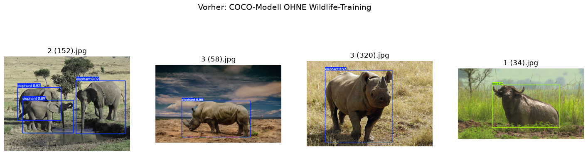

# Erstes Training in Google Colab

In diesem Praxisteil trainierst du ein YOLO26-Modell, das **Büffel, Elefanten, Nashörner und Zebras** erkennt.
Du musst nichts labeln: Wir verwenden den fertigen Datensatz [African Wildlife](https://docs.ultralytics.com/datasets/detect/african-wildlife/) von Ultralytics.

!!! abstract "Warum dieser Datensatz?"
    - **Klein genug** für ein schnelles Training (ca. 1.500 Bilder, 100 MB) – auf der kostenlosen Colab-GPU in **15–20 Minuten**.
    - **Gute Ergebnisse** schon nach 30 Epochen – du siehst, dass das Training funktioniert.
    - **Spannender Vorher-Nachher-Effekt:** Das Startmodell kennt Elefanten und Zebras, aber **keine Büffel und Nashörner**.

## Was ist Google Colab?

**[Google Colab](https://colab.research.google.com/)** ist ein kostenloser Dienst von Google, mit dem du
**Jupyter Notebooks** im Browser ausführen kannst – auf einem Rechner von Google **mit Grafikkarte (GPU)**.
Du brauchst nur ein Google-Konto.

| | Vorteil | Einschränkung |
|---|---|---|
| :material-check: | kostenlose GPU (meist NVIDIA T4), nichts zu installieren | Sitzung endet nach Inaktivität bzw. spätestens nach einigen Stunden |
| :material-check: | Python und viele Pakete schon vorhanden | **Dateien werden danach gelöscht** → Ergebnisse herunterladen oder in Drive speichern |
| :material-check: | läuft auf jedem Laptop | GPU-Kontingent ist begrenzt (bei sehr viel Nutzung kurz keine GPU) |

## Los geht's

[:material-google-colab: Notebook in Colab öffnen](https://colab.research.google.com/github/rdf-sul/YOLO_Training/blob/main/notebooks/01_erstes_training.ipynb){ .md-button .md-button--primary }
[:material-github: Notebook auf GitHub ansehen](https://github.com/rdf-sul/YOLO_Training/blob/main/notebooks/01_erstes_training.ipynb){ .md-button }

### Schritt für Schritt

1. Klicke auf **Notebook in Colab öffnen** und melde dich mit deinem Google-Konto an.
2. **GPU einschalten:** Menü **Laufzeit → Laufzeittyp ändern → T4 GPU → Speichern**.
3. Optional: **Datei → Kopie in Drive speichern**, damit deine Änderungen erhalten bleiben.
4. Führe die Zellen **der Reihe nach** aus (▶ links neben der Zelle oder ++shift+enter++).
5. Bei der Warnung *„Dieses Notebook wurde nicht von Google erstellt“* → **Trotzdem ausführen**.

!!! tip "Während das Training läuft (ca. 15–20 min) …"
    … öffne in einem zweiten Tab die Seite **[Ergebnisse verstehen](../training/ergebnisse.md)** und bearbeite die
    Experimente dort. Wenn dein Training fertig ist, kannst du deine eigenen Diagramme sofort deuten.

### Was im Notebook passiert

| Schritt | Inhalt | Theorie dazu |
|---|---|---|
| ⚙️ Einstellungen | Modell, Epochen, Bildgröße … an einer Stelle | [Parameter](../training/parameter.md) |
| 1 · GPU prüfen | `nvidia-smi` zeigt die Grafikkarte | – |
| 2 · Installation | `uv pip install --system ultralytics` | [Installation mit uv](../grundlagen/installation-uv.md) |
| 3 · Vorher-Test | COCO-Modell auf Wildlife-Bildern – was fehlt? | [Live-Demo](../grundlagen/live-demo.md) |
| 4 · Training | `model.train(data="african-wildlife.yaml", epochs=30)` | [Ablauf](../training/ablauf.md) |
| 5 · Ergebnisse | results.png, Confusion Matrix, PR-Kurve, Labels vs. Vorhersagen | [Ergebnisse verstehen](../training/ergebnisse.md) |
| 6 · Testen | Validierung auf den **Testbildern** pro Klasse | [Ergebnisse verstehen](../training/ergebnisse.md#map) |
| 7 · Eigene Bilder | Foto hochladen und prüfen | – |
| 8 · Sichern | `best.pt` herunterladen bzw. in Drive speichern | – |
| 🧪 Experimente | Epochen, Modellgröße, Bildgröße, Datenmenge, ohne Vorwissen, YOLO11 | – |

## Was du erwarten kannst

**Vorher** – das vortrainierte COCO-Modell kennt keine Nashörner und Büffel. Es wählt die ähnlichste Klasse, die es kennt:

{ loading=lazy .rahmen }
<small>Nashörner werden zu „elephant“, der Büffel zu „cow“ – mit hoher Confidence! Ein Modell sagt nie „das kenne ich nicht“.</small>

**Nachher** – schon unser Probetraining mit nur **12 Epochen auf einem Laptop ohne GPU** (imgsz=416) erreichte
eine **mAP50 von 0,95** und eine **mAP50-95 von 0,78**. Mit 30 Epochen und 640 px in Colab sollten deine Werte
mindestens so gut sein. Leichte Abweichungen sind normal, weil das Training Zufallselemente enthält.

!!! question "Diskussion"
    Das COCO-Modell war sich bei „elephant“ für ein Nashorn zu **93 %** sicher. Was bedeutet das für den Einsatz von KI
    in der Praxis – z. B. bei einer Bauteilprüfung, bei der plötzlich ein unbekanntes Bauteil auftaucht?

## 🧪 Klassen-Experiment: Wer findet das beste Setup?

Im Notebook gibt es am Ende eine Experimentier-Zelle. Teilt die Experimente in der Klasse auf –
**jede Gruppe ändert genau einen Parameter**:

| Gruppe | Experiment | Änderung | Vermutung vorher notieren! |
|---|---|---|---|
| A | Kurz trainiert | `epochs=10` | |
| B | Größeres Modell | `model="yolo26s.pt"` | |
| C | Kleine Bilder | `imgsz=320` | |
| D | Weniger Daten | `fraction=0.25` | |
| E | Ohne Vorwissen | `model="yolo26n.yaml"` | |
| F | Ältere Generation | `model="yolo11n.pt"` | |

Tragt am Ende **mAP50, mAP50-95 und Trainingszeit** an der Tafel zusammen und diskutiert:

- Welche Änderung hat **am meisten** Einfluss? Welche fast keinen?
- Was bringt mehr: **mehr Daten** oder ein **größeres Modell**?
- Warum ist Experiment E so viel schlechter? *(Stichwort: Transfer Learning)*

!!! warning "Fair vergleichen"
    Ändere **immer nur einen Parameter** gleichzeitig – sonst weißt du nicht, welcher die Wirkung hatte.
    Das ist dieselbe Regel wie bei jeder Messreihe im Labor.

