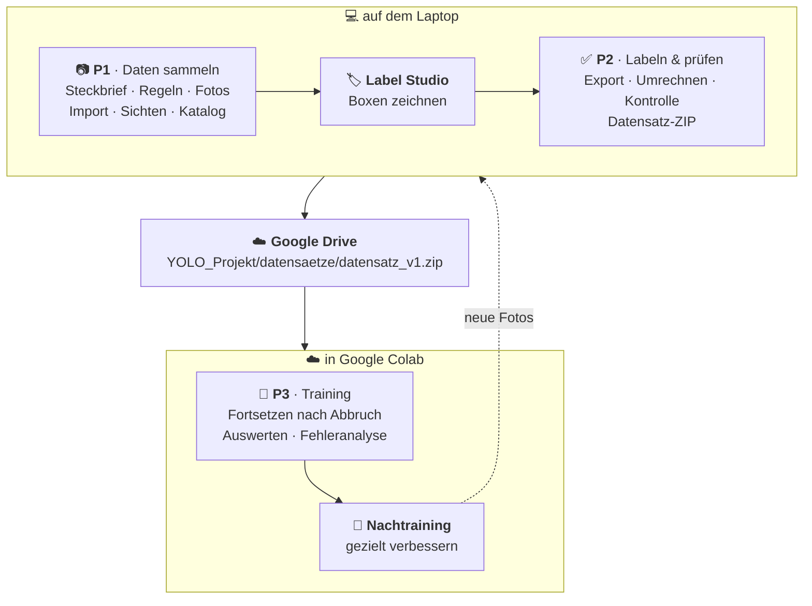

# Einheit 5 · Eigenes Projekt

Jetzt wird es ernst: **Du** entscheidest, was dein Modell erkennen soll. Du fotografierst, labelst und trainierst
selbst und verbesserst dein Modell in mehreren Runden. Dafür gibt es drei **Projekt-Notebooks**, die dich Schritt für
Schritt führen.



| Seite | Notebook | Ergebnis | Zeit (UE = Unterrichtseinheit à 45 min) |
|---|---|---|---|
| [Gute Trainingsbilder](bilder-aufnehmen.md) | – | du weißt, **wie** du fotografieren musst | 1 UE |
| [P1 · Daten sammeln](p1-daten-sammeln.md) | `P1_daten_sammeln.ipynb` | geprüfte Bilder in `2_bilder/` | 1–2 UE + Fotografieren |
| [P2 · Labeln und prüfen](p2-labeln.md) | `P2_labeln_und_pruefen.ipynb` | Datensatz-ZIP für Colab | 2–3 UE + Labeln (siehe unten) |
| [P3 · Training in Colab](p3-training.md) | `P3_training_colab.ipynb` | trainiertes Modell + Bewertung | 1–2 UE |
| [Nachtraining](nachtraining.md) | P1 → P2 → P3 | besseres Modell, Versions-Logbuch | 2+ UE |

!!! info "Wie lange dauert das Labeln? Rechne es für dein Projekt aus"
    Beispiel: 3 Klassen × 200 Objekte ÷ 4 Objekte pro Foto ≈ **150 Fotos**. Bei 20–60 s pro Foto sind das
    **50 min bis 2,5 h** Labelarbeit, verteilt auf die Gruppe. Plane einen Teil davon als Hausaufgabe ein.

## Projektvorlage einrichten

!!! warning "Hausaufgabe vor der ersten Projektstunde"
    Die Installation lädt über 1 GB herunter. Im Schul-WLAN dauert das mit 25 Laptops gleichzeitig ewig.
    Erledige die folgenden Schritte deshalb **zu Hause**. Du bist startklar, wenn beide Befehle ohne Fehler durchlaufen:

    ```bash
    uv sync
    ```
    ```bash
    uvx --python 3.12 --from label-studio==1.23.2 python -c "import label_studio; print('Label Studio', label_studio.__version__, 'ist bereit')"
    ```

Die Vorlage enthält die drei Notebooks, die Hilfsdatei `werkzeuge.py` und eine fertige uv-Projektbeschreibung.

[:material-download: Projektvorlage herunterladen (ZIP)](../downloads/yolo-projekt-vorlage.zip){ .md-button .md-button--primary }
[:material-github: Vorlage auf GitHub ansehen](https://github.com/rdf-sul/YOLO_Training/tree/main/projekt-vorlage){ .md-button }

1. ZIP entpacken, z. B. nach `C:\YOLO\` (es entsteht der Ordner `yolo-projekt\`).
   **Nicht** in einen OneDrive- oder Teams-Ordner **arbeiten**: Die Synchronisierung stört bei tausenden kleinen Dateien.
   (Zum **Übertragen** an andere sind OneDrive und Teams in Ordnung. Danach lokal entpacken.)
2. Im Projektordner ein Terminal öffnen (im Explorer in die Adresszeile `powershell` tippen und Enter drücken) und
   die Umgebung herstellen. Das dauert beim ersten Mal ein paar Minuten (PyTorch ist groß):

    ```bash
    uv sync
    ```

3. JupyterLab starten und `P1_daten_sammeln.ipynb` öffnen:

    ```bash
    uv run jupyter lab
    ```

??? note "Was steckt in der Vorlage?"
    ```text
    yolo-projekt/
    ├── P1_daten_sammeln.ipynb       ← lokal
    ├── P2_labeln_und_pruefen.ipynb  ← lokal
    ├── P3_training_colab.ipynb      ← in Google Colab
    ├── werkzeuge.py                 ← Hilfsfunktionen für P1 und P2 (Import, Katalog, Bildbrowser, Konverter …)
    ├── pyproject.toml / uv.lock     ← Pakete: ultralytics, jupyterlab, ipywidgets, pandas, pyyaml, pillow-heif
    └── README.md
    ```
    Die Ordner `1_rohbilder/` bis `4_datensatz/` legt P1 beim ersten Start selbst an.
    Label Studio wird **nicht** in das Projekt installiert. P2 startet es mit `uvx` in einer eigenen Umgebung,
    weil sich seine Pakete mit denen von Ultralytics nicht vertragen.

??? warning "Typische Stolpersteine"
    - **Windows-Firewall fragt beim Start von Label Studio:** „Zugriff zulassen“, nur für **private** Netzwerke.
    - **Port 8080 belegt** (Label Studio startet nicht): Ein anderes Programm nutzt den Port. In P2 `wz.labelstudio_starten(port=8081)` verwenden.
    - **Label-Studio-Konto:** Die E-Mail darf erfunden sein (z. B. `anna@projekt.local`). Das **Passwort gut merken**,
      denn es gibt kein Zurücksetzen per E-Mail. Das Konto existiert nur auf deinem Laptop.
    - **Webcam öffnet nicht:** Teams/Zoom schließen, in P1 `KAMERA = 1` probieren.

!!! tip "Jupyter-Grundlagen"
    Eine Zelle führst du mit ++shift+enter++ aus. Arbeite **von oben nach unten**. Nach einem Neustart
    (*Kernel → Restart*) musst du die Zellen ab dem Anfang des Notebooks erneut ausführen.
    Mehr dazu: [Installation mit uv → Jupyter](../grundlagen/installation-uv.md#schritt-4-jupyter-notebooks-lokal-nutzen).

## Projektideen aus der Elektrotechnik

| Idee | Klassen (Beispiel) | Schwierigkeit |
|---|---|---|
| Bauteile sortieren | `widerstand`, `led`, `kondensator`, `taster` | ⭐ |
| Werkzeug-Ausgabe prüfen | `seitenschneider`, `abisolierzange`, `schraubendreher` | ⭐ |
| Sicherheitsausrüstung | `helm`, `schutzbrille`, `handschuhe` | ⭐⭐ |
| Leitungen erkennen | `nym_3x1_5`, `nym_5x2_5`, `h07v_k` | ⭐⭐ |
| Lötstellen prüfen | `loetstelle_gut`, `loetstelle_kalt`, `bruecke` | ⭐⭐⭐ (kleine Objekte!) |
| Klemmen im Verteiler | `wago_221`, `reihenklemme`, `aderendhuelse` | ⭐⭐⭐ |

!!! warning "Realistisch planen"
    Wähle **2–4 Klassen**, die man auf einem Foto **mit bloßem Auge** klar unterscheiden kann.
    Projekte mit sehr kleinen Objekten (Lötstellen) oder sehr ähnlichen Klassen (Widerstandswerte!)
    brauchen deutlich mehr Bilder und Erfahrung.

## Wann ist das Projekt fertig?

Lege **vorher** im Steckbrief (P1) ein **Erfolgskriterium** fest, z. B.:

> „Jede Klasse erreicht auf val mAP50 ≥ 0,8, **und** im Webcam-Test am Laborplatz werden 9 von 10 Objekten richtig erkannt.“

Plane **höchstens zwei Nachtrainings-Runden**. Danach kommt der Abschlusstest mit den Testbildern, auch wenn das Ziel
noch nicht ganz erreicht ist. Zu erklären, **warum** es nicht gereicht hat, ist ein wertvolles Ergebnis.

## Arbeiten in der Gruppe

### Wer macht was auf welchem Laptop?

Ein Laptop ist die **Zentrale**: der Laptop der Projektleitung. Dort liegen der vollständige Projektordner und der Datensatz.

| Schritt | Wer | Was |
|---|---|---|
| 1 | **alle** | Vorlage einrichten (`uv sync`, siehe oben) |
| 2 | **alle** | fotografieren: Handyfotos bzw. Webcam-Fotos (P1, Abschnitt 4b) in den **eigenen** Ordner `1_rohbilder/<name>_<kamera>/` |
| 3 | **alle** | diese Ordner per USB-Stick oder Teams an die Projektleitung geben → dort in `1_rohbilder/` |
| 4 | Projektleitung | P1 Abschnitt 5–8 (Import, Sichten, Katalog), dann P2 Abschnitt 2 (Bildpakete verteilen) |
| 5 | Projektleitung | den Projektordner **ohne** `1_rohbilder/` an alle geben → jede Person entpackt ihn **lokal** |
| 6 | **alle** | Label Studio auf dem eigenen Laptop mit dem **eigenen Paket** einrichten und labeln (P2, Abschnitt 3–4) |
| 7 | **alle** | als JSON exportieren, Datei `<name>.json` an die Projektleitung (P2, Abschnitt 5) |
| 8 | Projektleitung | P2 ab Abschnitt 6: zusammenführen, prüfen, Datensatz-ZIP bauen |
| 9 | Training | ZIP in **das eine Gruppen-Drive** hochladen und P3 ausführen (siehe unten) |

!!! tip "Ein Google Drive pro Gruppe"
    P3 sucht den Datensatz in `Meine Ablage/YOLO_Projekt/` des Google-Kontos, mit dem Colab läuft. Ein Ordner,
    der nur „Mit mir geteilt“ ist, liegt **nicht** dort. Am einfachsten trainiert deshalb **eine** Person (Rolle Training)
    mit **ihrem** Konto, und die Projektleitung gibt ihr das ZIP per USB-Stick oder Teams.
    Ist das GPU-Kontingent dieses Kontos aufgebraucht, siehe [P3 · Keine GPU?](p3-training.md#keine-gpu-verfugbar).

### Rollen

| Rolle | Aufgaben |
|---|---|
| **Projektleitung** | Zentrale: Fotos sammeln, P1 und P2 ausführen, Pakete verteilen, Exporte zusammenführen, Datensatz bauen |
| **Fotografie** | sorgt dafür, dass der Aufnahmeplan erfüllt wird (Hintergründe, Licht, Einsatzkamera) |
| **Qualität** | geht in P2 die **Ausschnitte pro Klasse** durch und schickt eine **Fehlerliste mit Bildnamen** an die Person, die gelabelt hat |
| **Training** | führt P3 in Colab mit dem Gruppen-Drive aus, verwaltet Läufe und Modelle, führt das Versions-Logbuch |

**Alle** fotografieren und **alle** labeln. Die Rollen geben nur an, wer für was den Hut aufhat.
In einer **2er-Gruppe** übernimmt eine Person Projektleitung und Qualität, die andere Fotografie und Training.

## Was du am Ende abgibst

- [ ] **Steckbrief** (`projekt.yaml`): Ziel, Klassen, Definitionen, Einsatzort, Erfolgskriterium
- [ ] **Datensatz-Statistik** aus P2: Objekte pro Klasse, Aufteilung train/val/test
- [ ] **Ergebnisse** aus P3: Lernkurven, Tabelle pro Klasse, Confusion Matrix, Fehleranalyse, Testergebnis
- [ ] **Versions-Logbuch** über alle Nachtrainings-Runden ([Vorlage](nachtraining.md#dokumentation-das-versions-logbuch))
- [ ] **Vorführung** des Modells live mit der Webcam
- [ ] **Reflexion:** Wurde das Erfolgskriterium erreicht? Wo ist dein Modell gut, wo nicht, und warum? Was würdest du mit mehr Zeit verbessern?
