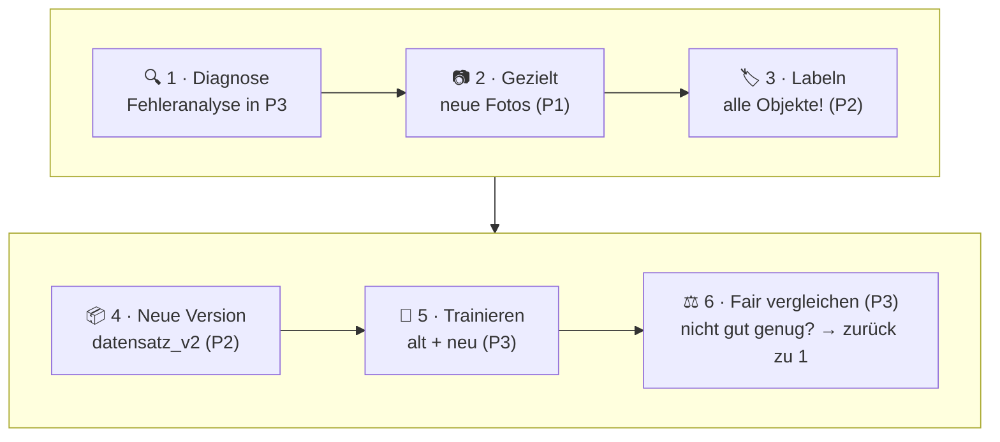

# Nachtraining – Best Practice

Dein erstes Modell ist fertig, aber es übersieht Taster bei Tageslicht oder hält Kondensatoren für LEDs.
Das ist **normal**. Professionelle KI-Modelle entstehen in mehreren **Runden**. Entscheidend ist,
**gezielt** nachzubessern statt einfach „mehr Bilder“ zu machen.

## 1 · Diagnose: Was genau ist das Problem?

Starte **nie** ohne Diagnose. Die Abschnitte 6.2–6.5 in P3 geben dir alle Informationen. Das **Diagnose-Blatt**
am Ende von Abschnitt 6.5 fasst sie zusammen:

| Beobachtung | Wahrscheinliche Ursache | Was hilft |
|---|---|---|
| Eine Klasse hat einen deutlich kleineren mAP50-95 als die anderen | zu wenige oder zu einheitliche Beispiele | **mehr Bilder dieser Klasse**, in neuen Situationen |
| Viele **übersehene** Objekte 🟧 | Objekte zu klein, verdeckt, ungewohnte Lage/Licht | Fotos **genau dieser Situationen**; ggf. `BILDGROESSE = 1280` |
| Viele **Fehlalarme** 🟥 | Störer sehen ähnlich aus (Kabel, Schrauben …) | **Hintergrundbilder** mit genau diesen Störern (*hard negatives*) |
| Zwei Klassen werden **verwechselt** 🟪 | Klassen sehen sich ähnlich, Definition unscharf | Bilder **beider** Klassen nebeneinander; Definition schärfen; ggf. Klassen zusammenlegen |
| val gut, aber im Einsatz schlecht | Trainingsbilder ≠ Einsatz (andere Kamera, Licht, Hintergrund) | Fotos **mit der Einsatzkamera am Einsatzort** |
| train-Loss sinkt, mAP50-95 auf val fällt | **Overfitting**: zu wenige, zu ähnliche Bilder | mehr **Vielfalt**; weniger Epochen; kleineres Modell |
| Modell „findet“ Objekte, die laut Label nicht da sind | **Label-Fehler**: vergessene Objekte | Labels korrigieren, siehe [3 · Nachlabeln](#3-nachlabeln-die-wichtigsten-regeln) |

!!! tip "Erst die Labels prüfen, dann neue Fotos machen"
    Schau dir die Bilder mit den meisten Fehlern **genau** an. Oft hat das Modell recht und **das Label ist falsch**.
    Eine Stunde Labels korrigieren bringt häufig mehr als eine Stunde neue Fotos.

## 2 · Gezielt neue Fotos aufnehmen

- **Wie viele?** Als Faustregel: Die Anzahl der Objekte der schwachen Klasse um **50–100 %** erhöhen.
- **Welche?** Genau die Situationen aus der Diagnose: Licht, Hintergrund, Abstand, Lage, Störer.
- Neue Fotos kommen wie gewohnt nach `1_rohbilder/`, gern in einen eigenen Unterordner (`anna_handy_runde2/`).
  P1 Abschnitt 5 importiert nur die neuen. Die alten Bilder bleiben unverändert.

## 3 · Nachlabeln: die wichtigsten Regeln

!!! danger "Regel 1: Auf neuen Bildern ALLE Objekte ALLER Klassen labeln"
    Du fotografierst gezielt Taster, aber auf dem Foto liegen auch zwei Widerstände? Dann **müssen** die Widerstände
    auch gelabelt werden. Sonst lernt das Modell: „Widerstände sind Hintergrund.“ Das verschlechtert die Klasse,
    die vorher gut war.

!!! danger "Regel 2: Neue Klasse = alle alten Bilder nachlabeln"
    Kommt eine **neue Klasse** dazu (z. B. `kondensator`), musst du **alle alten Bilder** durchsehen und die
    Kondensatoren darauf nachträglich labeln. Ein Kondensator ohne Box auf einem alten Bild bringt dem Modell bei:
    „Kondensator = Hintergrund.“

!!! warning "Regel 3: Die Reihenfolge der Klassen niemals ändern"
    Neue Klassen kommen **ans Ende** der Liste im Steckbrief. Die alten Klassen behalten ihre Nummer (0, 1, 2 …).
    In Label Studio fügst du die neue Klasse ebenfalls in der Label-Konfiguration hinzu
    (**Settings → Labeling Interface**, oder die neue Konfiguration aus P2 einfügen).

**So kommen die neuen Bilder in Label Studio:**

1. Projektleitung: neue Fotos in P1 importieren, sichten, Katalog (P1, Abschnitt 5–7).
2. Projektleitung: P2 Abschnitt 2 **erneut** ausführen. Es verteilt nur die **neuen** Bilder auf die vorhandenen Pakete.
3. Die Paketordner wieder an die Personen geben. Sie ersetzen damit ihren Ordner `2_bilder/<name>/`.
4. Jede Person: in Label Studio **Settings → Cloud Storage → Sync Storage**. Die neuen Bilder erscheinen als neue Aufgaben.
5. Labeln → **neu exportieren** → die alte Datei `<name>.json` **ersetzen** → Projektleitung: P2 ab Abschnitt 6.

## 4 · Neue Datensatz-Version bauen

In P2 Abschnitt 9: `VERSION = "v2"` und eine aussagekräftige `NOTIZ` (z. B. `"+60 Bilder Taster bei Tageslicht, +20 Hintergrundbilder mit Kabeln"`).

P2 sorgt automatisch für zwei Dinge, ohne die kein fairer Vergleich möglich wäre:

- **Alte Bilder bleiben in ihrer Teilmenge.** Ein Bild, das in v1 im Test lag, liegt auch in v2 im Test.
- **Neue Bilder werden auf train, val und test verteilt.** Auch die Prüfung enthält also die neuen Situationen.

!!! info "Warum nicht alle neuen Bilder ins Training?"
    Weil du dann nicht messen kannst, ob das Modell die neuen Situationen **gelernt** hat. Die Prüfung (val/test) muss
    die Situationen enthalten, die dich interessieren, also auch die neuen.

## 5 · Trainieren: alles neu oder nur ein Teil?

Das ist die wichtigste Entscheidung. Hier die Möglichkeiten im Vergleich:

| Variante | So geht's in P3 | Vorteile | Nachteile | Empfehlung |
|---|---|---|---|---|
| **A · Feintuning mit allen Daten** | `MODELL = "modelle/v1_yolo26n_best.pt"`, `DATENSATZ = "datensatz_v2"` (alt + neu) | schnell (weniger Epochen nötig), baut auf Gelerntem auf | übernimmt evtl. alte „Macken“ | ✅ **Standard**, wenn nur Bilder für vorhandene Klassen dazukommen |
| **B · Neu trainieren mit allen Daten** | `MODELL = "yolo26n.pt"`, `DATENSATZ = "datensatz_v2"` | sauber, reproduzierbar, gleiche Ausgangslage | dauert so lange wie das erste Training | ✅ empfohlen bei **neuer Klasse** (A geht dann auch), großen Änderungen (> 50 % neue Bilder) oder wenn A nicht besser wird |
| **C · Nur mit den neuen Bildern** | Datensatz nur mit neuen Bildern | sehr schnell | Modell **vergisst** Altes (*catastrophic forgetting*), Klassen unausgewogen | ❌ **nicht verwenden** |
| **D · Teile einfrieren** | wie A, zusätzlich `ZUSATZ = {"freeze": 10}` (die ersten 10 Schichten bleiben fest) | schneller, weniger Overfitting bei sehr wenigen Bildern | lernt neue Merkmale schlechter | nur bei **sehr wenigen** Bildern (< 100) |

!!! success "Faustregel"
    **Immer mit allen Bildern trainieren, alten und neuen.** Ob du vom alten `best.pt` (A) oder vom vortrainierten
    `yolo26n.pt` (B) startest, entscheidet der Vergleich in Schritt 6. Beides auszuprobieren kostet nur eine Colab-Sitzung.

??? note "Vertiefung: Warum vergisst ein Modell?"
    Beim Training werden die Gewichte so verändert, dass der Fehler **auf den aktuellen Trainingsbildern** sinkt.
    Kommen darin keine Widerstände mehr vor, gibt es auch keinen Grund, das Wissen über Widerstände zu erhalten.
    Die Gewichte werden für die neuen Bilder „umgebaut“. In der Fachsprache heißt das **catastrophic forgetting**.
    Dagegen hilft nur, die alten Beispiele **weiter mitzutrainieren** (*replay*). Genau das tun Variante A und B.

??? note "Vertiefung: Wie viele Epochen beim Feintuning?"
    Das alte Modell ist schon fast am Ziel. Meist reichen **50–60 % der ursprünglichen Epochen**
    (z. B. 60 statt 100). `PATIENCE` sorgt ohnehin dafür, dass das Training stoppt, wenn es nicht mehr besser wird.
    Ultralytics beginnt auch beim Feintuning mit einer kurzen Aufwärmphase (*warmup*) und einer automatisch gewählten
    Lernrate. Anpassen musst du nichts.

## 6 · Fair vergleichen

Ein Vergleich ist nur fair, wenn **beide Modelle auf denselben Bildern** geprüft werden.
In P3 setzt du dafür `VERGLEICH_MIT` auf den Namen des alten Laufs. Abschnitt 9 misst dann das
**alte und das neue Modell auf den val-Bildern von v2**.

!!! warning "Kleine Unterschiede sind Zufall"
    Schon zwei Trainings mit **identischen** Einstellungen unterscheiden sich, weil die Augmentation zufällig ist.
    Mit 20–60 val-Bildern schwankt mAP50-95 dadurch um etwa 0,02–0,05. Erst ab rund **0,03** spricht P3 von
    „besser“ oder „schlechter“.

!!! info "Neue Klasse? Dann nur die gemeinsamen Klassen vergleichen"
    Das alte Modell kennt eine neu hinzugekommene Klasse nicht. P3 vergleicht deshalb nur die **gemeinsamen** Klassen
    und zeigt die neue Klasse getrennt an.

| ✅ fair | ❌ unfair |
|---|---|
| altes und neues Modell auf **val von v2** | altes Modell auf val von v1, neues auf val von v2 |
| Vergleich von **mAP50-95** und pro Klasse | nur ein einziges Beispielbild anschauen |
| Testbilder erst **ganz am Ende** einmal | nach jeder Runde auf test schauen und daraufhin entscheiden |

Wurde es besser? → neues Modell verwenden und dokumentieren.
Kaum Unterschied? → Fehleranalyse wiederholen: Treffen die neuen Bilder wirklich die Schwäche?
Schlechter? → meist **Label-Fehler** in den neuen Bildern. Prüfe sie mit den Ausschnitten in P2 (Abschnitt 8.3).

## Dokumentation: das Versions-Logbuch

Führe für dein Projekt eine kleine Tabelle. Damit kannst du am Ende zeigen, **was** dein Modell verbessert hat:

| Datensatz | Lauf | Start | Änderung | Erwartung (Hypothese) | val mAP50-95 | schwächste Klasse | bestätigt? |
|---|---|---|---|---|---|---|---|
| v1 | v1_yolo26n | yolo26n.pt | erster Datensatz, 180 Bilder | – | 0,61 | Taster (0,42) | – |
| v2 | v2_feintuning | v1_yolo26n_best.pt | +60 Taster bei Tageslicht | Taster deutlich besser | 0,68 | Taster (0,57) | ja |
| v2 | v2_neu | yolo26n.pt | wie oben, neu trainiert | etwa wie Feintuning | 0,67 | Taster (0,55) | ja (Unterschied ist Zufall) |

