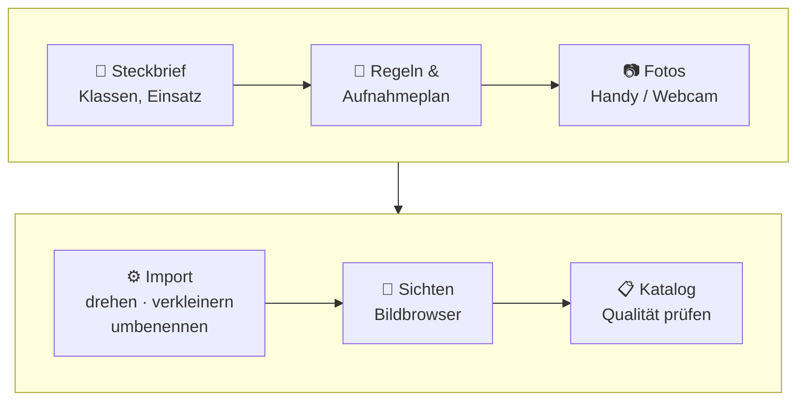
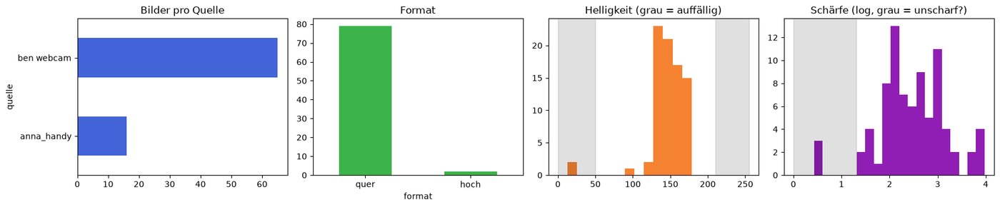

# P1 · Daten sammeln

**Notebook:** `P1_daten_sammeln.ipynb` · läuft **lokal** · Ergebnis: geprüfte Bilder in `2_bilder/`

Die Überschriften auf dieser Seite tragen dieselben Nummern wie die Abschnitte im Notebook.



## 2 · Der Projekt-Steckbrief

Bevor du fotografierst, legst du im Notebook fest: **Was** soll erkannt werden, **wo** und mit **welcher Kamera**?
Und vor allem: **Wie genau** wird jede Klasse gelabelt?

```python title="Ausschnitt aus P1, Abschnitt 2"
PROJEKT = {
    "name": "Bauteile erkennen",
    "klassen": ["LED", "Taster", "Widerstand"],
    "definitionen": {
        "Widerstand": "Körper mit Anschlussdrähten",   # gilt für die ganze Gruppe!
        ...
    },
    "kamera_im_einsatz": "Webcam",
    "ziel_objekte_pro_klasse": 200,
    "erfolgskriterium": "Jede Klasse mAP50 ≥ 0,8 auf val UND im Webcam-Test 9 von 10 Objekten erkannt",
}
```

Das **Erfolgskriterium** legt fest, wann das Projekt fertig ist (→ [Projektübersicht](index.md#wann-ist-das-projekt-fertig)).
Der Steckbrief wird als `projekt.yaml` gespeichert. P2 und P3 lesen ihn von dort, die Klassen stehen also nur
an **einer** Stelle. Das verhindert den häufigsten Fehler überhaupt: vertauschte Klassen-Reihenfolgen.

## 3 · Regeln und Aufnahmeplan

Aus Zielwert, Anzahl der Klassen und Objekten pro Foto berechnet P1, wie viele Fotos du ungefähr brauchst, und
verteilt sie auf alle Kombinationen aus **Hintergrund × Licht**. So gehst du systematisch vor wie bei einer
Messreihe im Labor. Die Regeln dahinter stehen auf der Seite [Gute Trainingsbilder](bilder-aufnehmen.md).

## 4 · Fotos aufnehmen

- **Handy:** normaler Fotomodus, per Kabel oder Cloud übertragen, **unverändert** nach `1_rohbilder/<name>_handy/`.
- **Webcam:** P1 öffnet ein Kamerafenster. ++space++ = Foto, ++s++ = Serienaufnahme an/aus, ++q++ = Ende.
  Die Serienaufnahme lohnt sich nur, wenn du die Objekte **zwischen** den Auslösungen bewegst.
  Die Fotos landen in `1_rohbilder/<name>_webcam/`.

Ein **Unterordner pro Person und Kamera** ist wichtig. Der Ordnername wird Teil des Dateinamens.
So siehst du später jedem Bild an, woher es stammt, auch in der Fehleranalyse.

## 5 · Importieren: Was passiert da eigentlich?

Die Zelle „Importieren“ verarbeitet jedes Foto aus `1_rohbilder/` in drei Schritten:

| Schritt | Warum? |
|---|---|
| **EXIF-Drehung übernehmen** | siehe unten |
| **Verkleinern** auf max. 1280 px | Das Training arbeitet mit 640 px. 12-MP-Fotos kosten nur Speicher und Zeit. |
| **Umbenennen** zu `<unterordner>_<original>.jpg` | eindeutig, keine Leer- und Sonderzeichen, HEIC/PNG → JPG |

Die Originale bleiben unverändert. Schon importierte Fotos werden übersprungen. Du kannst also jederzeit neue
Fotos hinzufügen und die Zelle wieder ausführen.

!!! warning "Das EXIF-Problem bei Handyfotos"
    Handys speichern Hochkant-Fotos oft **quer** und vermerken nur in den Metadaten (**EXIF**): „Bitte um 90° drehen“.
    Fotos-App und Explorer beachten das, manche Programme nicht. Dann zeigt Label Studio das Bild anders an,
    als das Training es liest, und **Boxen und Bild passen nicht zusammen**.

    P1 löst das, indem es die Drehung **fest in die Pixel übernimmt** und die Metadaten entfernt.
    Danach sieht jedes Programm das Bild gleich.

## 6–8 · Sichten, Katalog und Bilanz

Mit dem **Bildbrowser** blätterst du durch alle Bilder, drehst falsch herum liegende (⟲ ⟳) und sortierst schlechte
aus (🗑, sie landen in `2_bilder/_aussortiert/`). Anschließend misst der **Katalog** jedes Bild und markiert
Auffälligkeiten. Die Tabelle `katalog.csv` lässt sich in Excel öffnen.

{ loading=lazy .rahmen }
<small>Die Katalog-Übersicht aus P1 mit dem Bauteil-Datensatz: Bilder pro Quelle, Format, Helligkeit, Schärfe.
Grau hinterlegt sind auffällige Bereiche.</small>

| Kennzahl | Wie wird sie gemessen? | auffällig |
|---|---|---|
| **Helligkeit** | Mittelwert aller Grauwerte (0 = schwarz, 255 = weiß) | < 50 oder > 210 |
| **Kontrast** | Standardabweichung der Grauwerte | < 8 |
| **Schärfe** | Varianz des **Laplace-Filters** | < 20 |
| **fast doppelt** | Vergleich der **Bild-Fingerabdrücke** (Hash) | Abstand ≤ 20 von 256 Bit |

??? note "Vertiefung: Wie misst man Schärfe?"
    Der **Laplace-Filter** berechnet für jedes Pixel, wie stark es sich von seinen vier Nachbarn unterscheidet:

    $$
    L(x,y) = I(x{+}1,y) + I(x{-}1,y) + I(x,y{+}1) + I(x,y{-}1) - 4\,I(x,y)
    $$

    An scharfen Kanten ist $L$ groß (positiv oder negativ), in glatten Flächen fast 0.
    Ein scharfes Bild hat viele starke Kanten, also eine **große Streuung (Varianz)** von $L$.
    Ein unscharfes Bild hat verwaschene Kanten und eine kleine Varianz.
    Im Bauteil-Datensatz lagen normale Fotos zwischen etwa 25 und 9.400, ein künstlich verwischtes Foto bei 3.

??? note "Vertiefung: Wie erkennt man fast gleiche Bilder?"
    Jedes Bild wird auf 17 × 16 Pixel verkleinert und in Graustufen umgewandelt. Dann wird für jedes Pixel
    geprüft: Ist sein rechter Nachbar heller? Das ergibt 16 × 16 = **256 Bits**, den „Fingerabdruck“
    (*Differenz-Hash*). Zwei Bilder sind fast gleich, wenn sich ihre Fingerabdrücke nur in wenigen Bits unterscheiden.
    Echte Kopien haben den Abstand 0, verschiedene Szenen meist über 60.

<div class="quiz" data-titel="Kurz-Check: P1" data-quiz='[
 {"q": "Warum dreht P1 Handyfotos „fest“ und entfernt die EXIF-Daten?",
  "a": ["Damit die Dateien kleiner werden", "Damit alle Programme das Bild gleich herum sehen und Boxen später passen", "Weil YOLO keine JPGs lesen kann", "Aus Datenschutzgründen allein"],
  "c": 1, "e": "Sonst kann Label Studio ein Bild anders herum anzeigen, als das Training es liest."},
 {"q": "Du findest nach dem Labeln ein Bild, das auf dem Kopf steht. Was tust du?",
  "a": ["Im Bildbrowser drehen, fertig", "Nicht mehr drehen: Die Boxen passen zum Bild, so wie es ist. Stört es, das Bild aussortieren", "Das Bild in einem Bildprogramm drehen und speichern", "Die Labels von Hand umrechnen"],
  "c": 1, "e": "Nach dem Labeln sperrt P1 das Drehen, denn ein gedrehtes Bild passt nicht mehr zu seinen Boxen. Ein kopfstehendes, richtig gelabeltes Bild schadet dem Training nicht."},
 {"q": "Der Katalog meldet bei einem Bild „unscharf?“. Was bedeutet das?",
  "a": ["Das Bild ist sicher unbrauchbar", "Das Bild hat wenige scharfe Kanten – ansehen und selbst entscheiden", "Die Datei ist kaputt", "Das Bild ist zu groß"],
  "c": 1, "e": "Die Kennzahlen sind Hinweise. Eine glatte Fläche kann auch scharf fotografiert „unscharf?“ wirken."}
]'></div>
