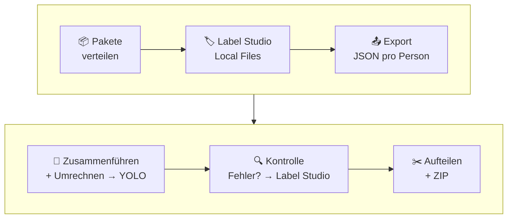
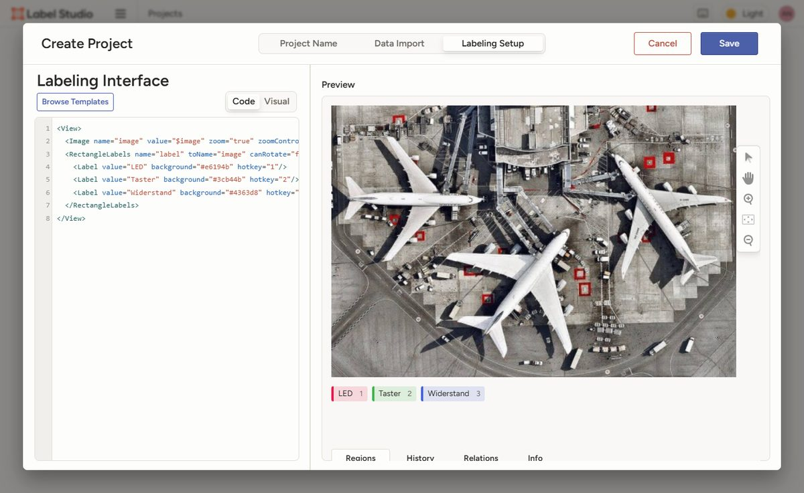
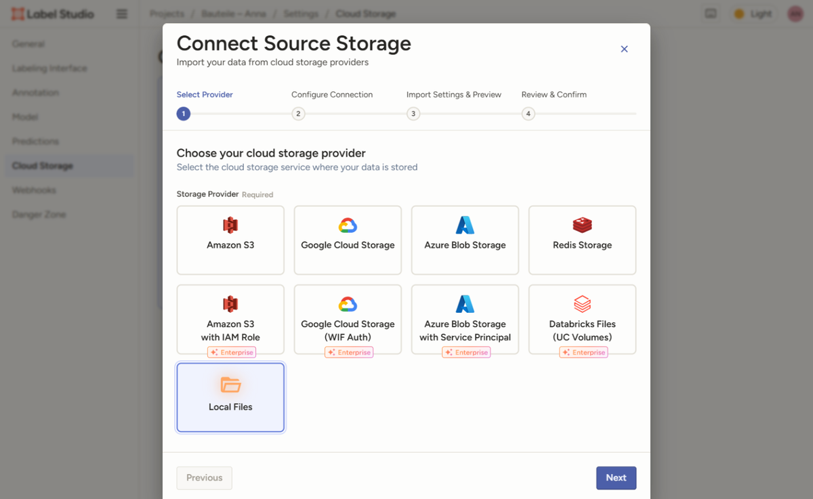
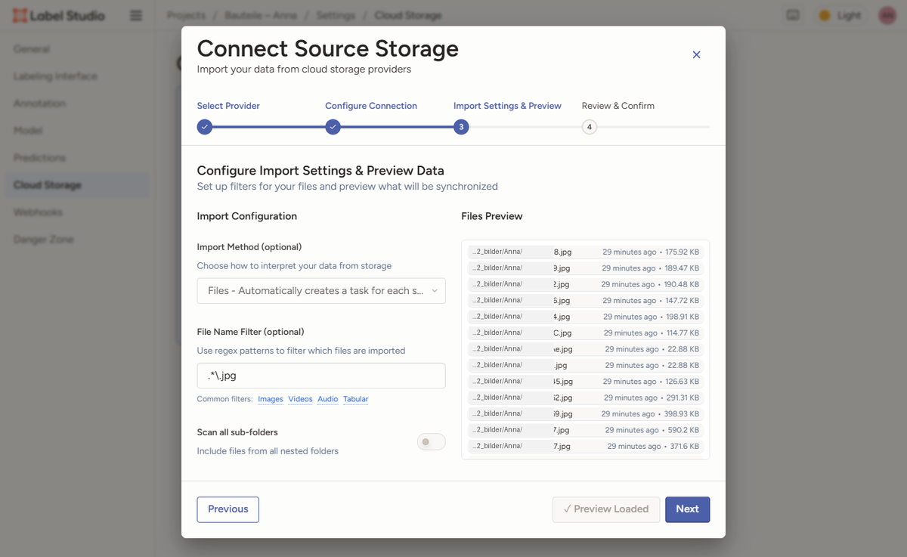
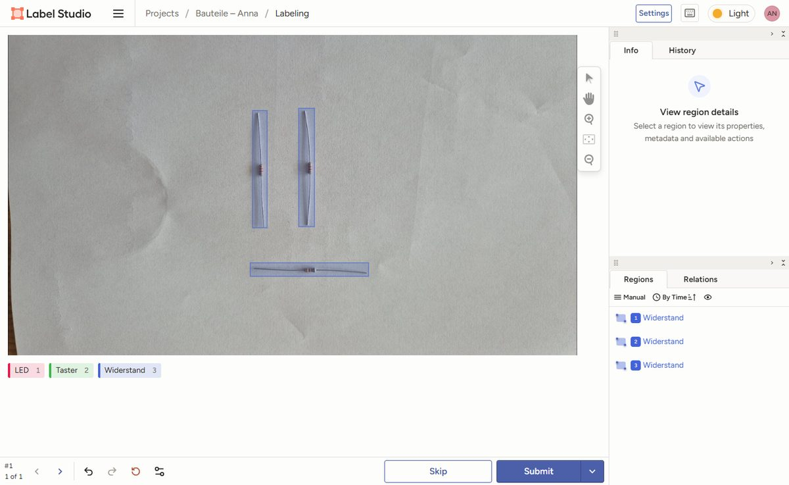
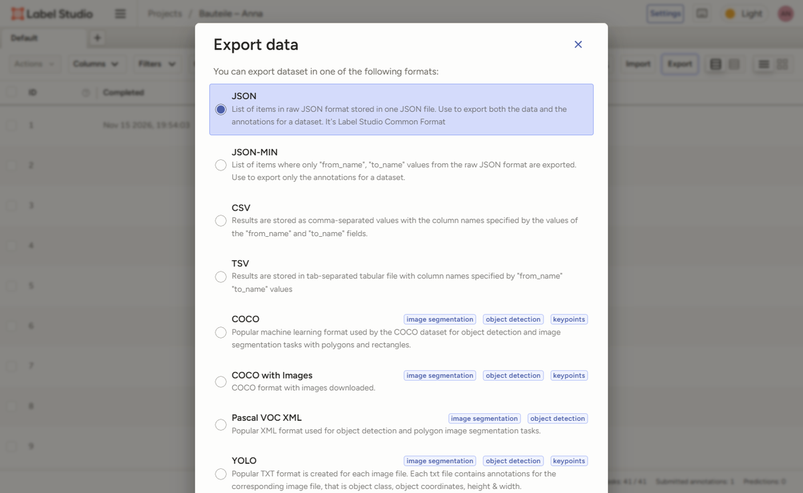
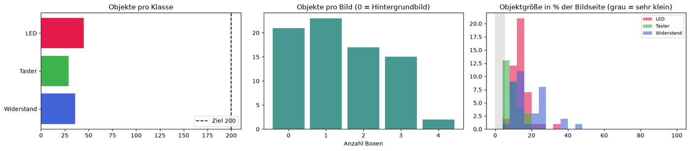

# P2 · Labeln und prüfen

**Notebook:** `P2_labeln_und_pruefen.ipynb` · läuft **lokal** · Ergebnis: Datensatz-ZIP für Colab

Die Überschriften auf dieser Seite tragen dieselben Nummern wie die Abschnitte im Notebook.



## 3–4 · Label Studio mit lokalem Ordner

Wir **laden keine Bilder hoch**. Label Studio liest sie direkt aus deinem Projektordner (*Local Files*).
Das spart Speicher, und die Dateinamen bleiben erhalten. Damit Label Studio auf den Ordner zugreifen darf,
braucht es beim Start zwei Einstellungen. Die setzt P2 automatisch:

```python
wz.labelstudio_starten()   # startet Label Studio im Hintergrund
```

??? note "Was passiert dabei genau?"
    P2 führt im Hintergrund diesen Befehl aus. Den kannst du auch selbst in einem Terminal im Projektordner starten:

    ```powershell
    $env:LABEL_STUDIO_LOCAL_FILES_SERVING_ENABLED = "true"
    $env:LABEL_STUDIO_LOCAL_FILES_DOCUMENT_ROOT = (Get-Location).Path
    uvx --python 3.12 label-studio==1.23.2 start
    ```

    `uvx` lädt Label Studio in eine **eigene** Umgebung. So stört es die Pakete deines Projekts nicht.

### Einrichten in vier Schritten

**① Projekt anlegen.** *Create Project* → Name → Reiter **Labeling Setup** → links unten **Custom template** →
die Label-Konfiguration aus P2 einfügen → **Save**.

{ loading=lazy .rahmen }
<small>Links der eingefügte Code aus P2, rechts die Vorschau mit den Klassen und ihren Tasten 1–3.</small>

**② Ordner verbinden.** Im leeren Projekt **Connect Cloud Storage** → **Local Files** → *Next*.
Dann den **Ordnerpfad** aus P2 bei *Absolute local path* einfügen → **Test Connection** → *Next*.

{ loading=lazy .rahmen }

**③ Importmethode wählen.** Ganz wichtig: *Import Method* = **Files – Automatically creates a task for each storage object**.
Mit *Load Preview* siehst du, welche Bilder gefunden werden → *Next* → **Save & Sync**.

{ loading=lazy .rahmen }

**④ Labeln.** **Label All Tasks** → Klasse mit ++1++ ++2++ ++3++ wählen → Box aufziehen → **Submit**.

{ loading=lazy .rahmen }
<small>Drei Widerstände, eng umrahmt, mit Anschlussdrähten, so wie es die Definition im Steckbrief verlangt.</small>

!!! success "Die Label-Regeln"
    1. **Jedes** Objekt jeder Klasse labeln, auch angeschnittene und teilweise verdeckte.
    2. **Eng** umrahmen, nichts abschneiden.
    3. Die **Definitionen aus dem Steckbrief** einhalten.
    4. Bild ohne Objekte → **Submit ohne Box** (= Hintergrundbild).
    5. Unklares Bild → **Skip** statt raten.

## 5 · Exportieren: Warum JSON und nicht YOLO?

{ loading=lazy .rahmen }

Label Studio bietet einen YOLO-Export an. Wir verwenden trotzdem **JSON**:

| | YOLO-Export | **JSON-Export** |
|---|---|---|
| Bilder enthalten? | bei *Local Files* **nein** (`images/` bleibt leer) | nicht nötig, die Bilder liegen ja schon in `2_bilder/` |
| Dateinamen | je nach Version und Importweg mit Kennung davor, **passen nicht zu den Bildern** | **Originalpfad** jedes Bildes steht drin |
| Mehrere Personen | Exporte überschreiben sich | jede Person eine Datei, P2 führt sie zusammen |
| Prüfbar | kaum | Bildgröße, Datum, übersprungen, wer gelabelt hat |

Jede Person benennt ihren Export um (`anna.json`, `ben.json`) und legt ihn nach `3_labelstudio_export/`.

## 6 · Zusammenführen und prüfen

P2 liest **alle** Exporte und meldet Probleme in einer Tabelle:

| Meldung | Bedeutung |
|---|---|
| doppelt gelabelt / **KONFLIKT** | ein Bild in zwei Exporten → die **neueste** Version zählt |
| Bild fehlt | Label da, Bild nicht (aussortiert oder umbenannt?) |
| **Bildgröße passt nicht** | Bild wurde **nach** dem Labeln gedreht → neu labeln |
| unbekannte Klasse | Tippfehler in der Label-Konfiguration |

## 7 · Umrechnen ins YOLO-Format

Label Studio speichert die **linke obere Ecke** in **Prozent**, YOLO braucht den **Mittelpunkt** als **Anteil**:

$$
x_\text{mitte} = \frac{x}{100} + \frac{1}{2}\cdot\frac{\text{width}}{100}
\qquad
y_\text{mitte} = \frac{y}{100} + \frac{1}{2}\cdot\frac{\text{height}}{100}
\qquad
b = \frac{\text{width}}{100}
\qquad
h = \frac{\text{height}}{100}
$$

In P2 programmierst du diese Umrechnung als Funktion `umrechnen()`. Ein eingebauter Test meldet sofort, ob sie stimmt.

??? success "Musterlösung für `umrechnen()` (erst selbst probieren!)"
    ```python
    def umrechnen(box):
        x      = box["x"] / 100
        y      = box["y"] / 100
        breite = box["width"] / 100
        hoehe  = box["height"] / 100
        x_mitte = x + breite / 2
        y_mitte = y + hoehe / 2
        return x_mitte, y_mitte, breite, hoehe
    ```

!!! example "Rechne selbst"
    Label Studio: `x = 25, y = 60, width = 10, height = 20`, Klasse `Taster` (Nummer 1). Wie lautet die YOLO-Zeile?

    ??? success "Lösung"
        $x_\text{mitte} = 0{,}25 + 0{,}05 = 0{,}30$ · $y_\text{mitte} = 0{,}60 + 0{,}10 = 0{,}70$ → `1 0.30 0.70 0.10 0.20`

## 8 · Kontrolle: Garbage in, garbage out

{ loading=lazy .rahmen }
<small>Statistik aus P2: Objekte pro Klasse mit Zielwert (gestrichelt), Objekte pro Bild, Objektgröße.</small>

P2 bietet drei Werkzeuge zur Kontrolle:

1. **Statistik:** Erreicht jede Klasse den Zielwert? Sind die Klassen ausgewogen? Gibt es sehr kleine Objekte?
2. **Labelbrowser:** Bilder mit eingezeichneten Boxen, filterbar nach Klasse oder „nur Hintergrundbilder“.
3. **Ausschnitte pro Klasse:** alle Objekte einer Klasse nebeneinander. Ein falsch gelabelter Kondensator
   zwischen 40 Widerständen fällt sofort auf, ebenso uneinheitliche Boxen.

## 9 · Aufteilen in train / val / test

| Teilmenge | Anteil | Rolle | Vergleich |
|---|---|---|---|
| **train** | 70 % | daraus lernt das Modell | Übungsaufgaben |
| **val** | 20 % | Kontrolle während des Trainings, Auswahl von `best.pt` | Probeklausur |
| **test** | 10 % | einmalige Abschlussbewertung | echte Prüfung |

P2 teilt nicht einfach zufällig auf. Drei Regeln machen die Bewertung **ehrlich**:

1. **Einmal zugeteilt, immer zugeteilt.** Die Zuteilung steht in `4_datensatz/aufteilung.csv`. Beim
   [Nachtraining](nachtraining.md) bleiben alle alten Bilder in ihrer Teilmenge.
2. **Serienfotos bleiben zusammen.** Fast gleiche Bilder kommen in **dieselbe** Teilmenge, sonst kennt das Modell
   die Prüfungsaufgaben schon (*Data Leakage*). Das **verringert** das Problem. Szenen, in denen nur die Objekte
   verschoben wurden, erkennt der Fingerabdruck nicht als Serie.
3. **Jede Klasse möglichst in jeder Teilmenge.** Neue Bilder gehen dorthin, wo gemessen am Soll noch am meisten fehlt.
   Bilder mit seltenen Klassen werden zuerst verteilt. Fehlt eine Klasse trotzdem in val oder test, warnt P2.

Das Ergebnis ist der Ordner `4_datensatz/datensatz_v1/` mit `data.yaml` und das **ZIP** dazu.
Die `data.yaml` enthält **kein** `path:`. Die Pfade gelten dann relativ zum Ordner der Datei, und derselbe
Datensatz läuft auf dem Laptop wie in Colab (→ [Die data.yaml](../daten/data-yaml.md)).

## 10 · Probelauf und Upload

Ein Training über **eine** Epoche mit kleinen Bildern prüft in 1–2 Minuten, ob Ultralytics den Datensatz lesen kann.
Danach kommt das ZIP in Google Drive nach `YOLO_Projekt/datensaetze/`, und es geht weiter mit [P3](p3-training.md).

<div class="quiz" data-titel="Kurz-Check: P2" data-quiz='[
 {"q": "Warum exportieren wir aus Label Studio als JSON statt als YOLO?",
  "a": ["JSON ist kleiner", "JSON enthält den Originalpfad jedes Bildes – so passen Labels und Bilder sicher zusammen", "YOLO-Format kann Ultralytics nicht lesen", "JSON ist schneller"],
  "c": 1, "e": "Der YOLO-Export enthält bei Local Files keine Bilder, und die Dateinamen passen je nach Version nicht."},
 {"q": "Label Studio: x = 10, y = 20, width = 30, height = 40. Was ist x_mitte im YOLO-Format?",
  "a": ["0.10", "0.25", "0.30", "0.40"],
  "c": 1, "e": "x_mitte = 10/100 + 30/100/2 = 0.10 + 0.15 = 0.25"},
 {"q": "Warum kommen Serienfotos derselben Szene in dieselbe Teilmenge?",
  "a": ["Damit das Training schneller ist", "Sonst steht ein fast gleiches Bild in train und val – die Bewertung wäre zu gut", "Weil sie sonst gelöscht werden", "Das ist egal"],
  "c": 1, "e": "Data Leakage: Das Modell kennt die Prüfungsaufgabe schon und die Kennzahlen täuschen."},
 {"q": "Zwei Personen haben dasselbe Bild gelabelt, einmal mit 2 und einmal mit 3 Boxen. Was macht P2?",
  "a": ["Es nimmt beide Versionen", "Es nimmt die neueste Version und meldet einen KONFLIKT", "Es bricht ab", "Es nimmt die Version mit weniger Boxen"],
  "c": 1, "e": "Bei KONFLIKT solltest du beide Versionen ansehen und das Bild ggf. in Label Studio korrigieren."}
]'></div>
