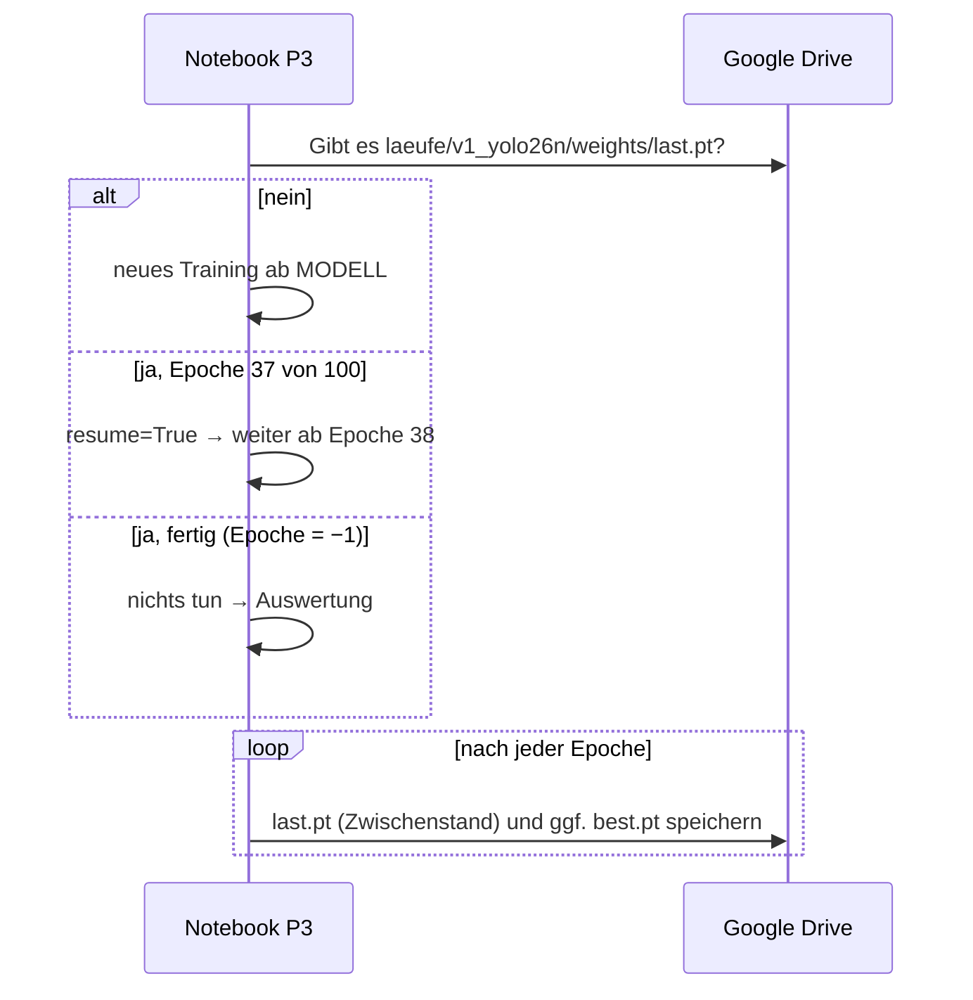
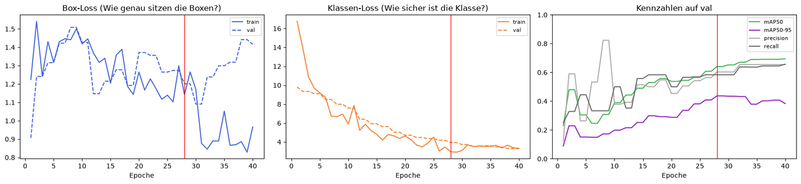
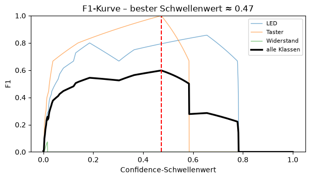
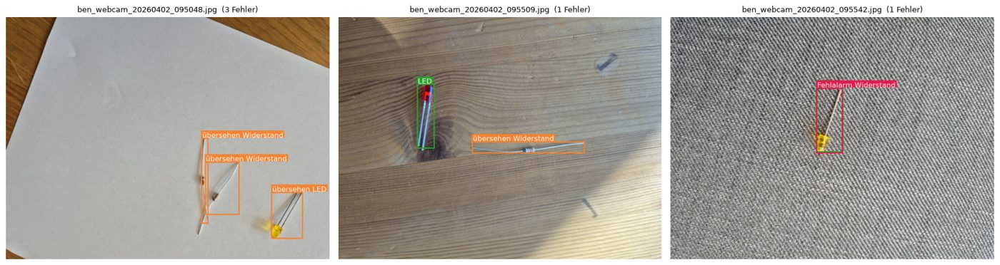

# P3 · Training in Google Colab

**Notebook:** `P3_training_colab.ipynb` · läuft in **Google Colab** · Ergebnis: trainiertes, bewertetes Modell

Die nummerierten Überschriften auf dieser Seite tragen dieselben Nummern wie die Abschnitte im Notebook.

[:material-google-colab: P3 in Colab öffnen](https://colab.research.google.com/github/rdf-sul/YOLO_Training/blob/main/projekt-vorlage/P3_training_colab.ipynb){ .md-button .md-button--primary }

## Vorbereitung

1. **Kopie speichern (Pflicht!):** In Colab **Datei → Kopie in Drive speichern** und nur noch in dieser Kopie arbeiten.
   Sonst sind deine Einstellungen nach einem Abbruch verloren.
2. **GPU einschalten:** **Laufzeit → Laufzeittyp ändern → T4 GPU**.
3. Das Datensatz-ZIP aus P2 nach `YOLO_Projekt/datensaetze/` in **deinem** Google Drive hochladen. Die Ordner
   `laeufe/` und `modelle/` legt P3 selbst an:

```text
Meine Ablage/
└── YOLO_Projekt/
    ├── datensaetze/
    │   ├── datensatz_v1.zip     ← aus P2 hochladen
    │   └── datensatz_v2.zip     ← nach dem Nachtraining
    ├── laeufe/
    │   └── v1_yolo26n/          ← alles zu einem Training: weights/last.pt, best.pt, results.csv, Diagramme
    └── modelle/
        ├── v1_yolo26n_best.pt   ← gesichertes Modell
        └── v1_yolo26n_info.json ← Datensatz, Kennzahlen, bester Schwellenwert
```

## Das Prinzip: Eine Runde = ein Durchlauf

Ein **Lauf** ist ein Trainingsvorgang mit festen Einstellungen und einem eigenen Namen. Für jede Runde änderst du
nur die Einstellungen oben im Notebook und wählst dann **Laufzeit → Alle ausführen**:

| Runde | Einstellungen |
|---|---|
| **1** · erstes Training | `DATENSATZ = "datensatz_v1"` · `LAUF = "v1_yolo26n"` · `MODELL = "yolo26n.pt"` |
| **2** · [Nachtraining](nachtraining.md) | `DATENSATZ = "datensatz_v2"` · `LAUF = "v2_feintuning"` · `MODELL = "modelle/v1_yolo26n_best.pt"` · `VERGLEICH_MIT = "v1_yolo26n"` |
| **Ende** | beim gewählten Lauf `ABSCHLUSSTEST = True` |

Jede Runde liefert automatisch Lernkurven, Kennzahlen pro Klasse, Confusion Matrix, besten Schwellenwert,
Fehleranalyse und eine gesicherte Modelldatei. Beim Nachtraining kommt der Vergleich mit dem vorherigen Lauf dazu.

!!! warning "Neuer Versuch = neuer Laufname"
    Bei gleichem `LAUF` setzt P3 den alten Lauf fort bzw. meldet „fertig“. Willst du mit **anderen Einstellungen**
    trainieren (größeres Modell, mehr Epochen …), gib dem Lauf einen **neuen Namen**, z. B. `LAUF = "v1_yolo26s"`.

## 5 · Abbruch? Kein Problem: Wie das Fortsetzen funktioniert

Kostenlose Colab-Sitzungen enden nach Inaktivität oder spätestens nach einigen Stunden, und alles auf der
Colab-Festplatte ist dann weg. Deshalb speichert P3 das Training **direkt in Google Drive**.



Ultralytics speichert in `last.pt` nicht nur die Gewichte, sondern auch den **Zustand des Optimierers**,
die Epochennummer und alle Einstellungen. Mit `resume=True` geht es deshalb genau dort weiter, wo es aufgehört hat.
Nach Abschluss wird `last.pt` „aufgeräumt“, und die Epoche steht dann auf −1. Daran erkennt P3 ein fertiges Training.
Ist `last.pt` beschädigt, weil der Abbruch genau beim Speichern passierte, setzt P3 mit `best.pt` fort.

Nach einem Abbruch: deine Notebook-Kopie öffnen → **Laufzeit → Alle ausführen**. Die Einstellungen dürfen sich
dazwischen nicht ändern.

### Keine GPU verfügbar?

Das kostenlose GPU-Kontingent ist **pro Google-Konto** begrenzt und erholt sich nach einigen Stunden. Auswege:

- später erneut versuchen,
- mit dem Konto einer anderen Person aus der Gruppe trainieren (ZIP dort nach `YOLO_Projekt/datensaetze/` hochladen),
- notfalls auf der CPU mit `BILDGROESSE = 416` und `EPOCHEN = 30`. Das dauert trotzdem lange.

## 6 · Auswerten

### 6.1 Lernkurven

{ loading=lazy .rahmen }
<small>Ein echtes Beispiel mit nur 29 Trainingsbildern und 40 Epochen. Die rote Linie markiert die beste Epoche.</small>

So liest du die Kurven:

- **mAP50-95 auf val** (lila) ist die entscheidende Kurve. Sie soll steigen und sich einpendeln.
  **Overfitting** erkennst du daran, dass sie wieder **fällt**, während der train-Loss weiter sinkt.
  Ein steigender val-Loss allein ist noch kein sicheres Zeichen.
- **In den letzten 10 Epochen** fällt der train-Loss oft sprunghaft, im Beispiel ab Epoche 31. Das ist **normal**:
  Ultralytics schaltet dann die Mosaik-Augmentation ab (`close_mosaic`), und die Trainingsbilder werden „leichter“.
- Bei sehr wenigen Bildern zittern die Kurven stark. Mit 29 Bildern macht das Modell pro Epoche nur wenige
  Lernschritte. Mit 200 Bildern werden die Kurven deutlich glatter.

### 6.2–6.3 Kennzahlen pro Klasse und Confusion Matrix

P3 zeigt eine Tabelle mit Precision, Recall, mAP50 und mAP50-95 **pro Klasse**, farbig von rot bis grün,
und nennt die **schwächste Klasse**. Vergleiche sie mit deiner Vermutung aus P2.
Die Confusion Matrix zeigt, was womit verwechselt wird.
Wie man sie liest, steht unter [Ergebnisse verstehen](../training/ergebnisse.md).

### 6.4 Der beste Schwellenwert

{ loading=lazy .rahmen width=520 }

Die **F1-Kurve** zeigt für jeden Confidence-Schwellenwert den Kompromiss aus Precision und Recall.
Ihr Maximum ist ein guter **Startwert** für den Einsatz. P3 speichert ihn in der Infodatei des Modells und gibt dir
den fertigen Befehl zum Testen aus.

Je nach Anwendung verschiebst du ihn bewusst: Soll **nichts übersehen** werden (fehlende Schutzbrille), wählst du
einen **niedrigeren** Wert und nimmst mehr Fehlalarme in Kauf. Sind Fehlalarme **teuer** (die Maschine stoppt),
wählst du einen **höheren** Wert.

### 6.5 Fehleranalyse

{ loading=lazy .rahmen }
<small>Die Bilder mit den meisten Fehlern: orange = übersehen, rot = Fehlalarm, grün = richtig, violett = verwechselt.
Hier werden vor allem Widerstände übersehen. Sie sind dünn und kontrastarm, und das Modell hatte nur 9 Beispiele.</small>

Kennzahlen sagen, **wie gut** ein Modell ist. Die Fehleranalyse sagt, **was falsch läuft**.
Für jedes Validierungsbild werden die Vorhersagen mit deinen Labels verglichen:

1. Zuerst werden Vorhersagen den Labels **gleicher Klasse** zugeordnet, wenn die Boxen ausreichend überlappen
   (**IoU ≥ 0,5**: Schnittfläche ÷ Vereinigungsfläche, siehe [IoU-Experiment](../training/ergebnisse.md#5-tp-fp-fn-und-die-iou)). Das sind die Treffer.
2. Übrige Vorhersagen, die auf einem Objekt **anderer** Klasse liegen, gelten als **verwechselt**, alle anderen als **Fehlalarm**.
3. Labels ohne passende Vorhersage sind **übersehen**.

Im **Diagnose-Blatt** unter der Analyse trägst du ein, welche Fehler in welchen Situationen auftreten.
Daraus entsteht dein Aufnahmeplan für das [Nachtraining](nachtraining.md#1-diagnose-was-genau-ist-das-problem).

### 9–10 · Vergleich und Abschlusstest

- **Vergleich** (Abschnitt 9, nur beim Nachtraining): altes und neues Modell auf **denselben** val-Bildern.
  Unterschiede unter etwa 0,03 mAP50-95 sind bei kleinen Datensätzen **Zufall**.
- **Abschlusstest** (Abschnitt 10): Erst wenn du dich für dein **endgültiges** Modell entschieden hast, setzt du
  `ABSCHLUSSTEST = True` und führst den Lauf noch einmal aus. Die Testbilder werden nur **ein einziges Mal** benutzt.

## 7–8 · Das Modell verwenden

P3 legt `best.pt` als `modelle/<LAUF>_best.pt` in Drive ab und bietet es zum Download an. Verschiebe die Datei aus
*Downloads* in deinen Projektordner. Den Befehl zum Testen mit der Webcam gibt P3 mit deinem Schwellenwert aus, z. B.:

```bash
uv run yolo predict model=v1_yolo26n_best.pt source=0 show=True conf=0.47
```

Oder mit den [Ultralytics Solutions](../praxis/solutions.md), z. B. zum **Zählen**:

```bash
uv run yolo solutions count model=v1_yolo26n_best.pt source=0 show=True
```

<div class="quiz" data-titel="Kurz-Check: P3" data-quiz='[
 {"q": "Colab bricht nach 50 von 100 Epochen ab. Was tust du?",
  "a": ["Neuen Laufnamen wählen und neu starten", "Notebook-Kopie öffnen, Laufzeit → Alle ausführen, Einstellungen unverändert", "Den Datensatz neu hochladen und neu starten", "Das Modell aus Epoche 50 ist fertig, weiter mit der Auswertung"],
  "c": 1, "e": "last.pt liegt in Drive. P3 erkennt den unterbrochenen Lauf und setzt ihn mit resume=True fort."},
 {"q": "Du willst yolo26s statt yolo26n ausprobieren. Was musst du ändern?",
  "a": ["Nur MODELL", "MODELL und einen neuen LAUF-Namen", "Nur den LAUF-Namen", "MODELL und DATENSATZ"],
  "c": 1, "e": "Bei gleichem LAUF-Namen würde P3 den alten Lauf fortsetzen oder als fertig melden."},
 {"q": "mAP50-95 auf val fällt in den letzten 20 Epochen deutlich, der train-Loss sinkt weiter. Was ist los?",
  "a": ["Underfitting: mehr Epochen trainieren", "Overfitting: Das Modell lernt die Trainingsbilder auswendig", "Die Lernrate ist zu klein", "Normal, das ist close_mosaic"],
  "c": 1, "e": "Abhilfe: mehr und vielfältigere Bilder. best.pt stammt zum Glück aus der besten Epoche. close_mosaic lässt den train-Loss fallen, aber nicht mAP auf val."},
 {"q": "Die Fehleranalyse zeigt viele violette Boxen „Taster→LED“. Was tust du zuerst?",
  "a": ["Sofort 100 neue LED-Fotos machen", "Die Labels und die Klassen-Definition von Taster und LED prüfen", "Ein größeres Modell wählen", "Den Schwellenwert erhöhen"],
  "c": 1, "e": "Verwechslungen haben oft unklare Definitionen oder vertauschte Labels als Ursache. Erst danach gezielt Bilder beider Klassen ergänzen."},
 {"q": "Nach dem Abschlusstest änderst du noch die Epochenzahl und trainierst neu. Was ist das Problem?",
  "a": ["Keins", "Der Test beeinflusst jetzt deine Entscheidungen und misst nicht mehr ehrlich", "Die Testbilder werden dabei gelöscht", "Colab erlaubt nur einen Test"],
  "c": 1, "e": "Der Testsatz ist nur dann ehrlich, wenn er erst ganz am Ende und nur einmal benutzt wird."}
]'></div>
