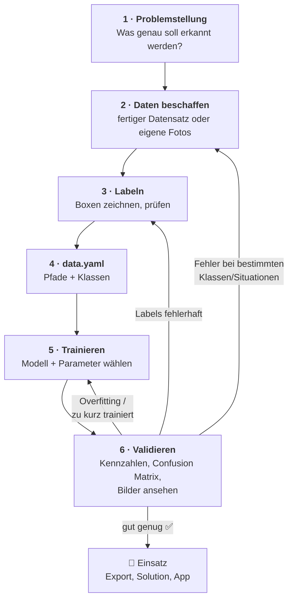
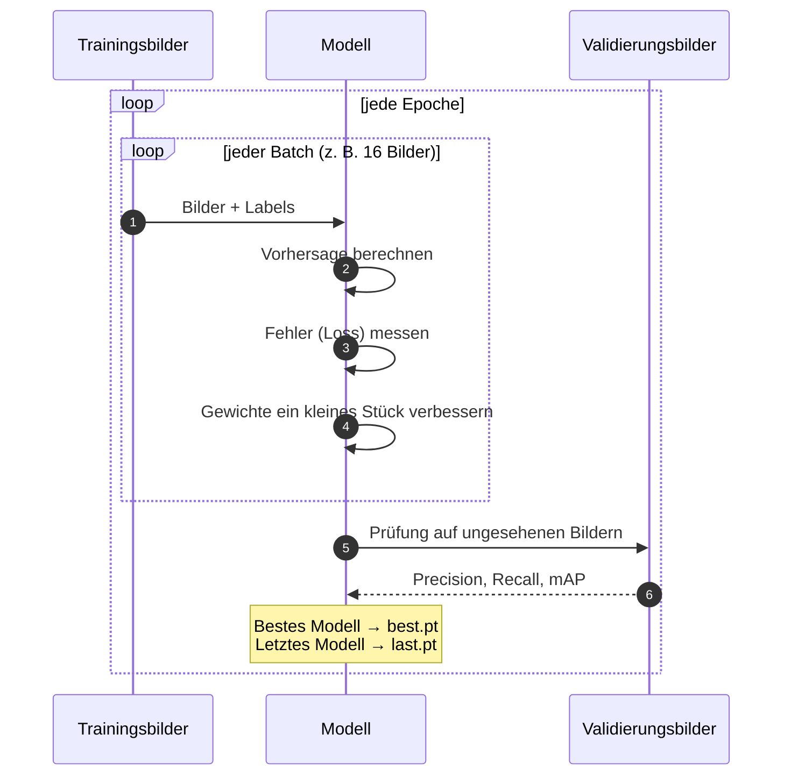

# Ablauf eines Trainings

Jedes YOLO-Projekt folgt denselben sechs Schritten. Häufig springt man dabei **zurück**: Wenn die Validierung
schlecht ausfällt, liegt die Ursache meistens bei den Daten – nicht beim Modell.



## 1 · Problemstellung

Die wichtigste – und am häufigsten übersprungene – Phase. Kläre **vorher**:

| Frage | Beispiel „Platinenprüfung“ |
|---|---|
| **Was** genau soll erkannt werden? | Widerstand, Kondensator, IC, Diode – fehlt eines? |
| Welcher **Task**? | Detektion (zählen + Position) |
| **Wo** wird das Modell eingesetzt? | Kamera über dem Prüfplatz, Industrie-PC ohne GPU |
| Wie **schnell** muss es sein? | 1 Bild pro Sekunde reicht |
| Wie **genau**? Was ist schlimmer: Fehlalarm oder übersehenes Bauteil? | Übersehen ist schlimmer → hoher **Recall** wichtig |
| Was ist **Erfolg**? | ≥ 95 % der fehlenden Bauteile werden gefunden |

## 2 · Daten beschaffen

Fertigen Datensatz suchen oder eigene Fotos machen → siehe [Datensätze finden](../daten/datensaetze.md).
Die Bilder sollten der **späteren Einsatzsituation** möglichst ähnlich sein (gleiche Kamera, gleiches Licht, gleicher Abstand).

## 3 · Labeln

Mit Label Studio Boxen zeichnen, anschließend stichprobenartig **kontrollieren** → siehe [Daten labeln](../daten/labeln.md).

## 4 · data.yaml

Datensatz in train/val/test aufteilen und die `data.yaml` schreiben → siehe [Die data.yaml](../daten/data-yaml.md).

## 5 · Trainieren

Ein vortrainiertes Modell laden und mit `train()` starten:

=== "Python"

    ```python
    from ultralytics import YOLO

    model = YOLO("yolo26n.pt")            # vortrainiertes Modell (Transfer Learning)
    model.train(
        data="platinen.yaml",             # Datensatz
        epochs=50,                        # Durchläufe durch alle Trainingsbilder
        imgsz=640,                        # Bildgröße
        batch=16,                         # Bilder pro Rechenschritt
        name="platinen_v1",               # Name des Ergebnisordners
    )
    ```

=== "Kommandozeile"

    ```bash
    uv run yolo train model=yolo26n.pt data=platinen.yaml epochs=50 imgsz=640 batch=16 name=platinen_v1
    ```

Was dabei im Hintergrund passiert, zeigt das folgende Schema:



## 6 · Validieren

Nach dem Training wird das **beste** Modell (`best.pt`) noch einmal gründlich geprüft:

```python
model = YOLO("runs/detect/platinen_v1/weights/best.pt")
metrics = model.val(data="platinen.yaml", split="test")   # auf den Testbildern
print(metrics.box.map50, metrics.box.map)                  # mAP50 und mAP50-95
```

Wie man die Ergebnisse liest, lernst du auf der Seite [Ergebnisse verstehen](ergebnisse.md).

!!! tip "Nicht nur auf Zahlen schauen!"
    Schau dir immer auch **Bilder** an, auf denen das Modell Fehler macht. Oft sieht man sofort ein Muster:
    „Bei Gegenlicht versagt es“, „Rote LEDs werden mit Widerständen verwechselt“ → dann gezielt **mehr solche Bilder** sammeln.

<div class="quiz" data-titel="Kurz-Check: Ablauf" data-quiz='[
 {"q": "Bringe die Schritte in die richtige Reihenfolge. Welche ist korrekt?",
  "a": ["Labeln → Problemstellung → Training → data.yaml", "Problemstellung → Daten → Labeln → data.yaml → Training → Validieren", "Training → Labeln → Daten → Validieren", "data.yaml → Daten → Problemstellung → Training"],
  "c": 1, "e": "Erst das Problem klären, dann Daten sammeln und labeln, dann beschreiben (data.yaml), trainieren und prüfen."},
 {"q": "Dein Modell erkennt Bauteile bei Tageslicht gut, bei Kunstlicht schlecht. Was ist der sinnvollste nächste Schritt?",
  "a": ["Mehr Epochen trainieren", "Ein größeres Modell nehmen", "Mehr Trainingsbilder mit Kunstlicht aufnehmen und labeln", "Die Confidence-Schwelle senken"],
  "c": 2, "e": "Das Modell hat diese Situation nie gesehen – nur passende Daten lösen das Problem wirklich."},
 {"q": "Welche Datei verwendest du nach dem Training für den Einsatz?",
  "a": ["last.pt", "best.pt", "data.yaml", "yolo26n.pt"],
  "c": 1, "e": "best.pt ist der Stand mit der besten Leistung auf den Validierungsbildern."}
]'></div>
