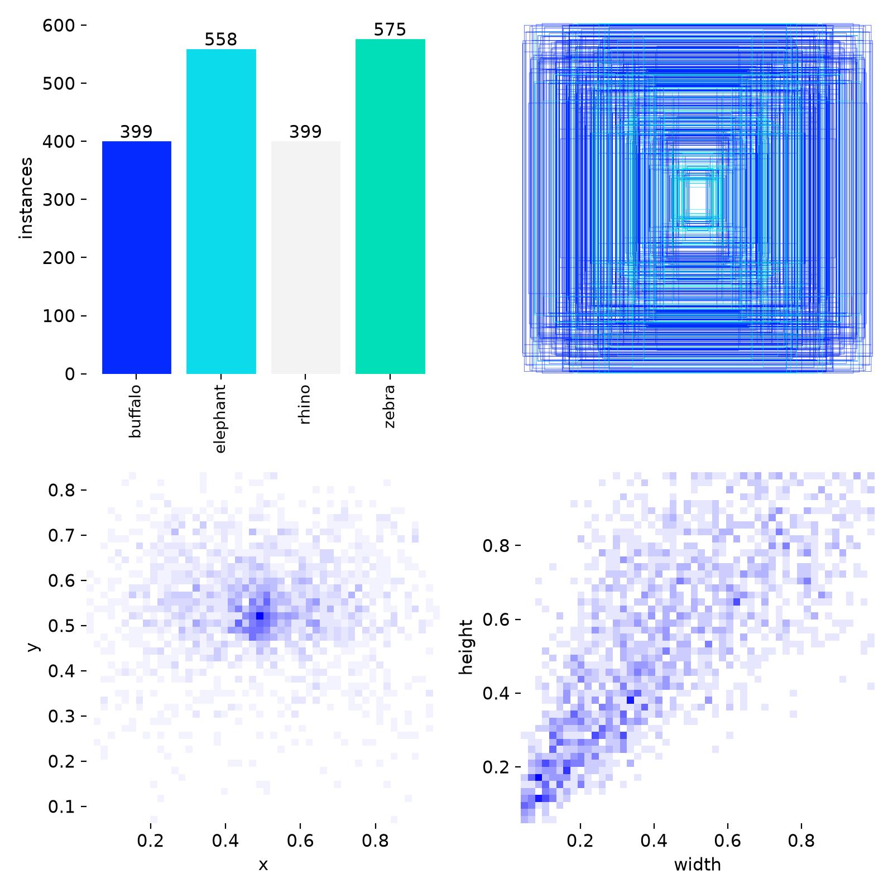
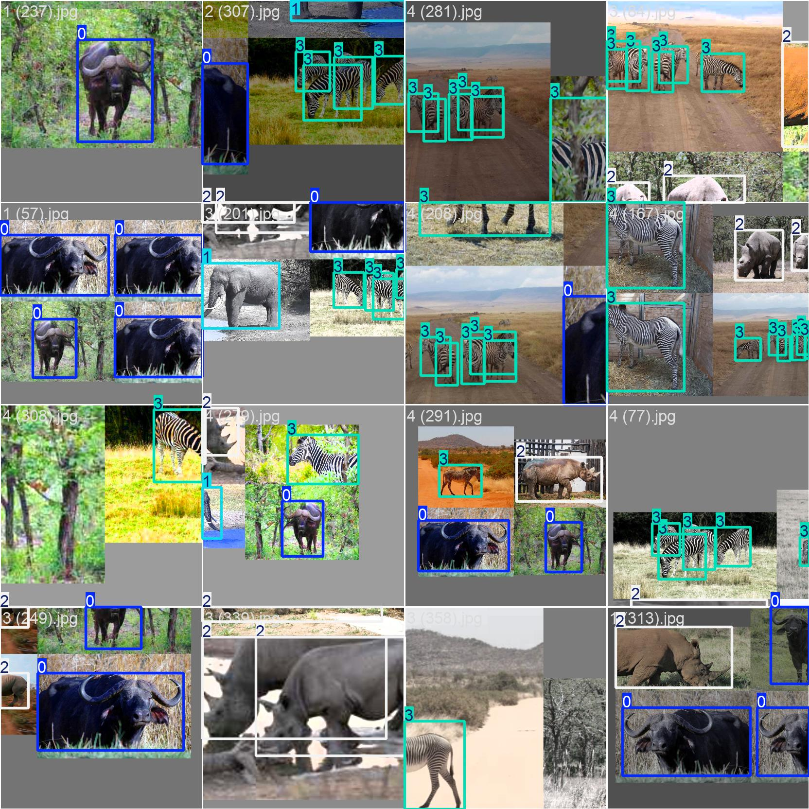
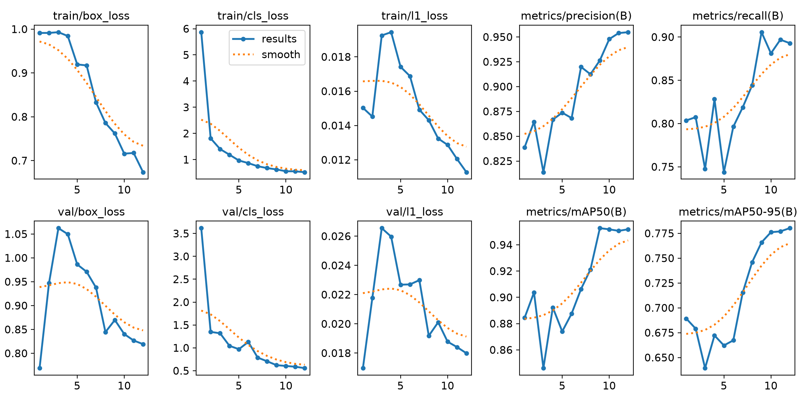
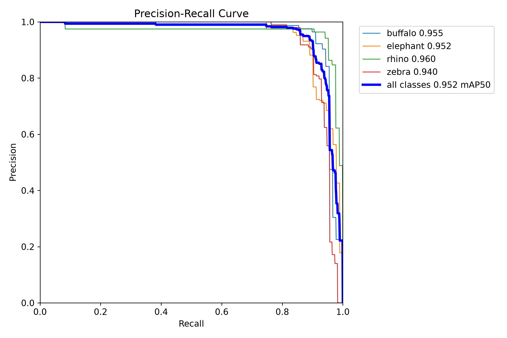
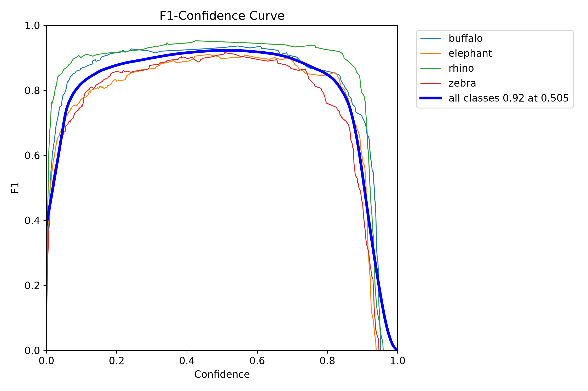
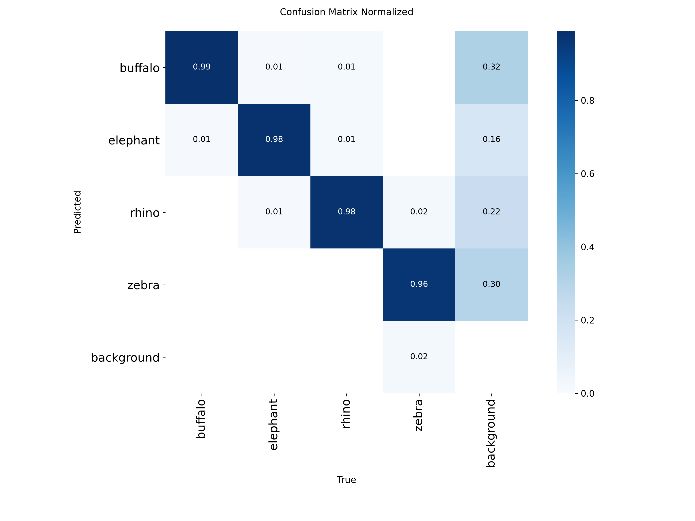
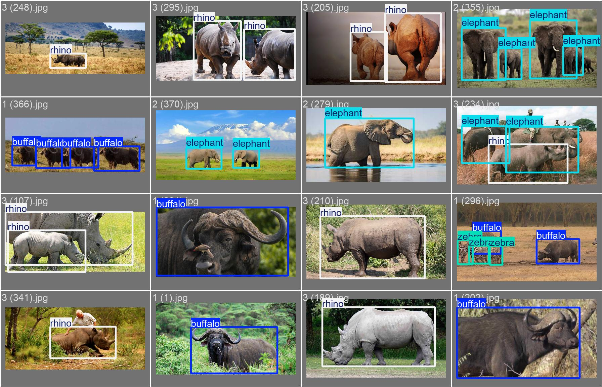
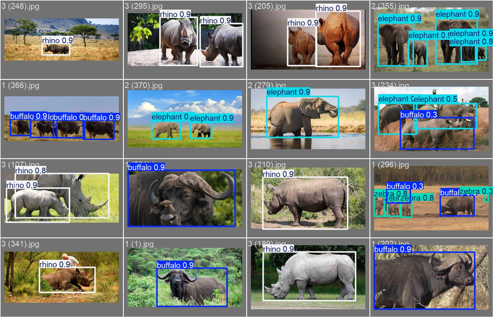

# Ergebnisse verstehen

Nach dem Training legt Ultralytics einen Ordner voller Diagramme und Zahlen an. Auf dieser Seite lernst du,
**was jede Ausgabe bedeutet** und wie du daraus ablesen kannst, ob dein Modell gut ist – und wo es hakt.

!!! info "Echte Ergebnisse"
    Alle Diagramme auf dieser Seite stammen aus einem echten Probetraining: **YOLO26n auf African Wildlife**,
    nur 12 Epochen, `imgsz=416`, **auf einem Laptop ohne GPU**. Dein Colab-Training (30 Epochen, 640 px) wird noch
    etwas bessere Werte erreichen – die Diagramme sehen aber genauso aus.

## 1 · Wo liegt was?

```text
runs/detect/wildlife_n_30ep/          ← Ergebnisordner (Name = Parameter name)
├── weights/
│   ├── best.pt                       ← ⭐ bestes Modell → für den Einsatz
│   └── last.pt                       ← Stand nach der letzten Epoche → zum Weitertrainieren
├── args.yaml                         ← alle verwendeten Parameter (Dokumentation!)
├── results.csv                       ← alle Kennzahlen pro Epoche als Tabelle
├── results.png                       ← Loss- und Metrik-Kurven
├── labels.jpg                        ← Statistik über die Labels (Datengüte)
├── train_batch0.jpg …                ← Trainingsbilder mit Augmentation und Labels
├── val_batch0_labels.jpg             ← Validierungsbilder mit den richtigen Labels
├── val_batch0_pred.jpg               ← dieselben Bilder mit den Vorhersagen
├── confusion_matrix.png              ← Verwechslungstabelle (absolut)
├── confusion_matrix_normalized.png   ← Verwechslungstabelle (in Prozent)
├── BoxPR_curve.png                   ← Precision-Recall-Kurve
├── BoxF1_curve.png                   ← F1 über der Confidence-Schwelle
├── BoxP_curve.png / BoxR_curve.png   ← Precision bzw. Recall über der Confidence
```

??? question "Und wo liegen die Bilder und Labels des Datensatzes?"
    Ultralytics lädt Datensätze in einen eigenen **Datensatz-Ordner**. Wo der liegt, verrät dir:

    ```bash
    uv run yolo settings
    ```

    → Eintrag `datasets_dir`. In **Colab** ist das meist `/content/datasets/`, darin z. B. `african-wildlife/images/…` und `african-wildlife/labels/…`.
    Bei eigenen Datensätzen steht der Ort in deiner [data.yaml](../daten/data-yaml.md) unter `path`.

## 2 · Die Konsolenausgabe

Nach jeder Epoche (und am Ende) erscheint eine Tabelle wie diese:

```text
                 Class     Images  Instances      Box(P          R      mAP50  mAP50-95)
                   all        225        379      0.957      0.895      0.952      0.781
               buffalo         62         89      0.955      0.910      0.957      0.786
              elephant         53         91      0.929      0.879      0.952      0.775
                 rhino         55         85      0.964      0.934      0.959      0.810
                 zebra         59        114      0.980      0.857      0.940      0.751
```

| Spalte | Bedeutung |
|---|---|
| **Class** | Klasse (`all` = Durchschnitt über alle) |
| **Images** | Anzahl Validierungsbilder, auf denen die Klasse vorkommt |
| **Instances** | Anzahl gelabelter Objekte dieser Klasse |
| **P** (Precision) | Wie viele der gemeldeten Boxen sind richtig? |
| **R** (Recall) | Wie viele der vorhandenen Objekte wurden gefunden? |
| **mAP50** | mittlere Average Precision bei IoU ≥ 0,5 („Box ungefähr richtig“) |
| **mAP50-95** | gemittelt über IoU 0,5 … 0,95 („Box auch genau richtig“) – **das strengste und wichtigste Maß** |

*(Echte Ausgabe unseres Probetrainings nach 12 Epochen auf der CPU.)* Die Fachbegriffe klären wir jetzt Schritt für Schritt.

!!! question "Erste Beobachtung"
    Das Zebra hat die höchste **Precision** (0,980), aber den niedrigsten **Recall** (0,857). Was bedeutet das in Worten?

    ??? success "Lösung"
        Wenn das Modell „Zebra“ meldet, stimmt das fast immer (wenige Fehlalarme). Es **übersieht** aber relativ viele
        Zebras – z. B. in Herden, wo sich die Tiere stark überlappen.

## 3 · Datengüte prüfen – *vor* den Kennzahlen

Bevor du Kennzahlen interpretierst, prüfe, ob die **Daten** in Ordnung sind. Fehler in den Daten erklären die meisten schlechten Ergebnisse.

### labels.jpg – Statistik der Labels

{ loading=lazy width=560 .rahmen }

| Teildiagramm | Was du ablesen kannst | Warnsignal |
|---|---|---|
| **Balken oben links** | Anzahl Labels pro Klasse | eine Klasse hat viel weniger Labels → wird schlechter erkannt (**Klassen-Ungleichgewicht**) |
| **Boxen oben rechts** | alle Boxen übereinander gelegt (Form und Größe) | – |
| **x/y unten links** | wo im Bild die Objekte liegen | alle Objekte immer in der Mitte → Modell versagt am Bildrand |
| **width/height unten rechts** | Größe der Boxen relativ zum Bild | sehr viele winzige Boxen → `imgsz` erhöhen |

### train_batch – So sieht das Modell die Trainingsbilder

{ loading=lazy width=560 .rahmen }

Hier siehst du die **Augmentation** (Mosaik aus 4 Bildern, Spiegelung, Farbänderungen) und die **Labels**.
Prüfe stichprobenartig: Sitzen die Boxen richtig? Fehlen Labels? Stimmen die Klassennamen?

## 4 · Loss-Kurven: results.png

{ loading=lazy .rahmen }

**Obere Reihe: Training, untere Reihe: Validierung.** Die x-Achse zeigt die Epochen.

| Kurve | Bedeutung | Soll |
|---|---|---|
| `box_loss` | Wie gut passen die **Positionen und Größen** der Boxen? | ↘ sinken |
| `cls_loss` | Wie gut stimmen die **Klassen**? | ↘ sinken |
| `l1_loss` | zusätzlicher Box-Fehler im neuen YOLO26 (ersetzt den älteren `dfl_loss` von YOLO11) | ↘ sinken |
| `precision`, `recall` | siehe unten | ↗ steigen |
| `mAP50`, `mAP50-95` | siehe unten | ↗ steigen, dann flach |

!!! tip "So liest du results.png"
    - **Alles sinkt bzw. steigt noch deutlich?** → Mehr Epochen hätten geholfen (*Underfitting*).
    - **Kurven werden flach?** → Das Training ist ausgereizt. Mehr bringt nur noch: mehr/bessere Daten, größeres Modell.
    - **val-Loss steigt wieder, train-Loss sinkt weiter?** → *Overfitting* (siehe [Parameter](parameter.md)).
    - Die gepunktete Linie („smooth“) ist eine geglättete Version – nicht verwirren lassen.

## 5 · TP, FP, FN und die IoU

Um eine Vorhersage zu bewerten, vergleicht man sie mit dem Label (der *Ground Truth*):

| Fall | Bedeutung | Beispiel |
|---|---|---|
| **TP** – True Positive | richtige Klasse **und** Box passt (IoU ≥ Schwelle) | Zebra erkannt, Box sitzt |
| **FP** – False Positive | Fehlalarm: falsche Klasse, Box passt nicht oder da ist gar nichts | Stein als Nashorn erkannt |
| **FN** – False Negative | Objekt übersehen | Büffel im Schatten nicht erkannt |

Ob eine Box „passt“, entscheidet die **IoU** (*Intersection over Union*):

\[
\text{IoU} = \frac{\text{Schnittfläche}}{\text{Vereinigungsfläche}} = \frac{|A \cap B|}{|A \cup B|}
\]

<div class="exp" data-exp="iou"></div>

!!! example "Aufgaben"
    1. Schiebe die orange Box so, dass die IoU genau **0,5** ist. Sieht das für dich noch nach einem „Treffer“ aus?
    2. Stelle die Schwelle auf **0,95**. Wie genau musst du die Box jetzt platzieren?
    3. Spiele das **Schätzspiel** 5-mal. Liegst du eher zu hoch oder zu niedrig?

## 6 · Precision und Recall

\[
\text{Precision} = \frac{TP}{TP + FP} \qquad\qquad \text{Recall} = \frac{TP}{TP + FN}
\]

| | Frage | Hoch ist wichtig, wenn … |
|---|---|---|
| **Precision** | *„Wenn das Modell etwas meldet – stimmt es dann?“* | Fehlalarme teuer sind (z. B. Band wird unnötig gestoppt) |
| **Recall** | *„Findet das Modell alles, was da ist?“* | Übersehen gefährlich ist (z. B. fehlendes Sicherheitsbauteil, Person im Gefahrenbereich) |

Beide hängen von der **Confidence-Schwelle** ab – und arbeiten **gegeneinander**:

<div class="exp" data-exp="pr"></div>

!!! example "Aufgaben"
    1. Bei welcher Schwelle ist der **Recall** maximal? Wie hoch ist dann die Precision?
    2. Bei welcher Schwelle ist die **Precision = 1,0**? Wie viele Widerstände werden dann übersehen?
    3. Finde die Schwelle mit dem besten **F1-Wert** (Kompromiss aus beiden).
    4. Warum erreicht der Recall **nie** 1,0, egal wie niedrig die Schwelle ist?

    ??? success "Lösungen"
        1. Bei Schwelle ≤ 0,15 → Recall 0,90, Precision nur 0,60.
        2. Bei Schwelle > 0,88 → Precision 1,0, aber nur 3 von 10 gefunden (7 übersehen).
        3. Bei einer Schwelle zwischen 0,41 und 0,48: F1 ≈ 0,76 (TP 8, FP 3, FN 2).
        4. Ein Widerstand wurde vom Modell überhaupt **nicht** vorgeschlagen – ihn kann keine Schwelle „retten“.

### Die Kurven aus dem echten Training

<div class="grid2" markdown>
<figure markdown>
{ loading=lazy .rahmen }
<figcaption><b>PR-Kurve:</b> eine Linie pro Klasse. Je näher an der rechten oberen Ecke, desto besser. Die Fläche darunter ist die AP.</figcaption>
</figure>
<figure markdown>
{ loading=lazy .rahmen }
<figcaption><b>F1-Kurve:</b> F1 über der Confidence-Schwelle. Das Maximum zeigt die beste Schwelle für den Einsatz.</figcaption>
</figure>
</div>

## 7 · AP und mAP – die wichtigste Kennzahl { #map }

- **AP (Average Precision)** = Fläche unter der Precision-Recall-Kurve einer Klasse. Sie bewertet das Modell über **alle** Schwellen hinweg – nicht nur für eine.
- **mAP (mean AP)** = Mittelwert der AP über **alle Klassen**.

| Kennzahl | IoU-Schwelle | Aussage |
|---|---|---|
| **mAP50** | 0,5 | „Findet das Modell die Objekte und erkennt es die Klasse?“ – die Box muss nur grob passen |
| **mAP50-95** | Mittelwert über 0,5; 0,55; 0,6; … 0,95 | „… und sitzen die Boxen auch **genau**?“ – viel strenger |

!!! abstract "Faustregeln zur Einordnung (Detektion)"
    | mAP50 | Einschätzung |
    |---|---|
    | < 0,5 | schwach – Daten/Labels prüfen |
    | 0,5 – 0,7 | brauchbar für erste Versuche |
    | 0,7 – 0,9 | gut |
    | > 0,9 | sehr gut (bei einfachen, klar unterscheidbaren Objekten erreichbar) |

    Die mAP50-95 liegt typischerweise **15–30 Prozentpunkte darunter**. Zum Vergleich: YOLO26x erreicht auf dem
    schweren COCO-Datensatz mit 80 Klassen eine mAP50-95 von 0,575.

## 8 · Die Confusion Matrix

Die **Confusion Matrix** (Verwechslungsmatrix) zeigt, **welche Klasse als welche erkannt wurde**.

{ loading=lazy width=600 .rahmen }

**So liest du sie:**

- **Spalten = Wahrheit** (Label, *True*), **Zeilen = Vorhersage** (*Predicted*).
- **Diagonale** = richtig erkannt. Je dunkler, desto besser. Ideal: 1,00 auf der ganzen Diagonalen.
- **Außerhalb der Diagonalen** = Verwechslungen. Beispiel: Zeile *elephant*, Spalte *rhino* → Nashörner, die als Elefant erkannt wurden.
- **Spalte background** = Fehlalarme (FP): Das Modell meldet ein Tier, wo keines gelabelt ist. (In der normalisierten Matrix zeigt sie, wie sich *alle* Fehlalarme auf die Klassen verteilen.)
- **Zeile background** = übersehen (FN): Ein gelabeltes Tier wurde gar nicht gefunden.

!!! question "Lies die Matrix oben ab!"
    1. Welches Tier wird am **zuverlässigsten** erkannt?
    2. Welche **Verwechslung** zwischen zwei Tierarten kommt vor? Ist sie plausibel?
    3. Wie viel Prozent der Zebras werden **übersehen**?
    4. Bei welcher Klasse entstehen die meisten **Fehlalarme**?

    ??? success "Lösung"
        1. **Büffel** (0,99), knapp vor Elefant und Nashorn (je 0,98). Zebras: 0,96.
        2. **2 % der Zebras werden als Nashorn** erkannt (Zeile *rhino*, Spalte *zebra*). Sonst gibt es nur je 1 % Verwechslungen –
           das Modell trennt die Arten sehr gut.
        3. **2 %** (Zeile *background*, Spalte *zebra*) – z. B. Tiere, die in einer Herde verdeckt sind.
        4. In der Spalte *background* stehen die Fehlalarme, aufgeteilt nach der gemeldeten Klasse: **32 % aller Fehlalarme
           sind „Büffel“**, 30 % „Zebra“. Ein dunkler Stein oder Busch wird also am ehesten für einen Büffel gehalten.

??? note "Normalisiert oder absolut?"
    `confusion_matrix.png` zeigt die **Anzahl** der Fälle, `confusion_matrix_normalized.png` die **Anteile** pro Spalte
    (jede Spalte summiert sich zu 1). Die normalisierte Version ist besser vergleichbar, wenn die Klassen
    unterschiedlich viele Labels haben.

## 9 · Bilder vergleichen: Labels vs. Vorhersagen

<div class="grid2" markdown>
<figure markdown>
{ loading=lazy .rahmen }
<figcaption><b>val_batch0_labels.jpg</b> – die richtigen Labels</figcaption>
</figure>
<figure markdown>
{ loading=lazy .rahmen }
<figcaption><b>val_batch0_pred.jpg</b> – die Vorhersagen mit Confidence</figcaption>
</figure>
</div>

!!! example "🧪 Fehlersuche"
    Vergleiche die beiden Bilder. Findest du …

    - ein Tier, das **übersehen** wurde (FN)?
    - einen **Fehlalarm** (FP)?
    - eine Box mit **niedriger Confidence** – warum ist sich das Modell da unsicher?
    - ein Tier, bei dem du selbst nicht sicher wärst? *(Auch Labels können falsch sein!)*

## 10 · Checkliste: Ist mein Modell gut genug?

- [ ] `labels.jpg`: Haben alle Klassen ähnlich viele Labels?
- [ ] `train_batch*.jpg`: Sitzen die Labels richtig?
- [ ] `results.png`: Sind die Kurven am Ende flach? Kein Overfitting?
- [ ] **mAP50** und **mAP50-95** im erwarteten Bereich – auch für **jede einzelne Klasse**?
- [ ] **Confusion Matrix**: Welche Verwechslungen gibt es? Sind sie für die Anwendung kritisch?
- [ ] **Precision oder Recall** – was ist für meine Anwendung wichtiger? Passende Confidence-Schwelle aus der F1-/P-/R-Kurve gewählt?
- [ ] Auf **Testbildern** geprüft (`split="test"`) und echte Bilder aus dem Einsatz ausprobiert?

<div class="quiz" data-titel="Abschluss-Check: Ergebnisse verstehen" data-quiz='[
 {"q": "Ein Modell meldet 20 Boxen, 15 davon sind richtig. Es gibt insgesamt 25 Objekte. Wie groß sind Precision und Recall?",
  "a": ["P = 0,75 und R = 0,60", "P = 0,60 und R = 0,75", "P = 0,80 und R = 0,80", "P = 0,75 und R = 0,75"],
  "c": 0, "e": "TP = 15, FP = 5, FN = 10. P = 15/20 = 0,75; R = 15/25 = 0,60."},
 {"q": "Was misst die mAP50-95 im Vergleich zur mAP50 zusätzlich?",
  "a": ["Die Geschwindigkeit", "Wie genau die Boxen sitzen (strengere IoU-Schwellen)", "Die Anzahl der Klassen", "Die Größe des Modells"],
  "c": 1, "e": "Bei IoU-Schwellen bis 0,95 zählt eine Vorhersage nur als Treffer, wenn die Box sehr genau passt."},
 {"q": "In der Confusion Matrix ist in der Zeile background, Spalte rhino ein hoher Wert. Was bedeutet das?",
  "a": ["Viele Nashörner wurden übersehen", "Viele Fehlalarme als Nashorn", "Nashörner wurden als Zebra erkannt", "Es gibt keine Nashörner im Datensatz"],
  "c": 0, "e": "Wahrheit = rhino (Spalte), Vorhersage = background (Zeile): Das Nashorn war da, wurde aber nicht gefunden (FN)."},
 {"q": "Bei einer Sicherheitsanwendung (Person im Gefahrenbereich) ist welche Kennzahl besonders wichtig?",
  "a": ["Precision", "Recall", "Anzahl der Epochen", "Modellgröße"],
  "c": 1, "e": "Eine übersehene Person (FN) ist gefährlich – ein Fehlalarm ist dagegen nur lästig. Also hoher Recall."},
 {"q": "Die val-Losskurven in results.png fallen am Ende noch deutlich. Was folgt daraus?",
  "a": ["Overfitting – sofort aufhören", "Das Modell hätte von mehr Epochen profitiert", "Die data.yaml ist falsch", "Die GPU ist zu langsam"],
  "c": 1, "e": "Solange die Validierung sich noch verbessert, ist das Training nicht ausgereizt."}
]'></div>
